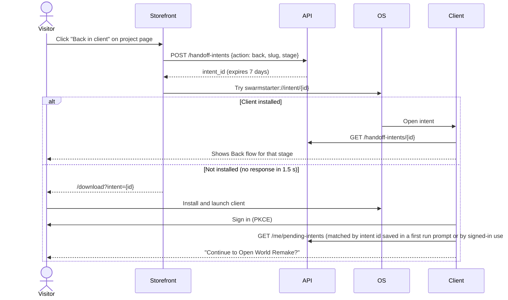
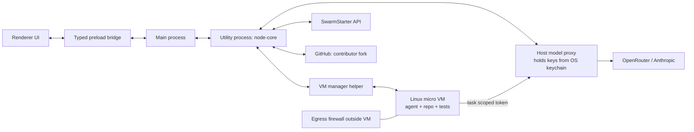

# SwarmStarter Addendum A: Client-First (Steam-style) Architecture

**Applies to:** SwarmStarter Build Spec v1.0 (`SPEC.md`)
**Date:** November 24, 2026
**Decision owner:** Rex St John
**Status:** Approved direction. This addendum **overrides SPEC.md wherever they conflict**. Where it is silent, SPEC.md (including Section 19A, the normative contracts and launch gates) still applies.

> All projects, people, numbers, versions, hashes and dollar amounts in this addendum and in the `mockups/client-*.png` files are **example data**.

---

## A0. Decision summary

1. **SwarmStarter is a desktop client first**, similar to how a game launcher works. Everything a signed-in user does happens in the client: create projects, back stages, vote, propose, appeal, run swarm work, use the forum, manage the wallet and keys.
2. **The website becomes a thin, browse-only storefront.** It exists for discovery, trust and SEO: home (featured hero, carousel, grid), project pages (trailer, funding bar, stages), read-only governor log and rulings, the verify page, and the **Get the client** download page. Every action button on the web becomes **Open in client** (or **Get the client** if it is not installed).
3. **One backend serves both.** The REST API from SPEC.md Section 8 is unchanged in shape. The client is the main API consumer; the web storefront uses only public read endpoints plus the auth handoff.
4. **The swarm worker lives inside the client** (not a separate app). The CLI stays for headless and Linux servers.
5. **The client shell moves to M1.** Milestones are renumbered (Section A12).
6. **Mobile companion scope is unchanged** (SPEC.md Q12): monitor, vote, approve, review, light tasks.

### A0.1 Decisions made in this addendum (with defaults; Rex can override)

| # | Decision | Default chosen | Why |
|---|---|---|---|
| D1 | Desktop framework | **Electron** (replaces Tauri 2 from SPEC.md 12.1) | The client is now the whole app, not a tray utility. Bundled Chromium renders the same on macOS and Windows; the swarm core is TypeScript and runs natively in an Electron utility process; mature signing, notarization and auto-update tooling. Tauri remains a valid later optimization for size. |
| D2 | Platforms | **macOS (Apple silicon and Intel) and Windows 10/11 x64 at launch.** Linux AppImage as beta. Windows on ARM later. | Covers most contributors; Linux users also have the CLI. |
| D3 | Web sign-in | Web has **sign-in only for auth handoff and account essentials** (receipts, data export, account deletion, device approval). No creation, voting, funding or forum on the web. | Privacy and consumer rules need a browser path to receipts and deletion; everything else is client only. |
| D4 | What the web shows read-only | Project page, stages, spec (current version), updates, proposal list and proposal pages (read-only with tallies after close), governor log and rulings, verify page. **Forum is client only.** | Transparency and SEO for governance; forum moderation stays in one place. |
| D5 | Payments in the client | Stripe Payment Element inside a **dedicated, isolated payment window** that loads a hosted SwarmStarter payment page over HTTPS (no Node access, strict CSP). Fallback: open Stripe Checkout in the system browser. | Card data never touches client code; PCI scope stays with Stripe. |
| D6 | Mobile purchases | **No pledges or credit purchases in the mobile companion in v1.** | Avoids app store in-app purchase questions until counsel reviews. |
| D7 | Sandbox runtime | **Bundled lightweight Linux VM** managed by the client (Apple Virtualization framework on macOS; WSL2 distro or Hyper-V on Windows). Docker or Podman used only if the user opts in. | SPEC.md 19A.5 requires VM-grade isolation for hostile repos; removes the "install Docker first" friction. |
| D8 | Release channels | **Stable, Beta, Nightly.** Default Stable. | Lets Rex dogfood Nightly without risking backers. |
| D9 | Deep link scheme | **`swarmstarter://`** plus Universal Links (macOS) and an HTTPS fallback path `https://swarmstarter.verafy.ai/open/...`. | Works from X posts, Discord and the web. |
| D10 | Client local storage | **SQLite** (encrypted with a key held in the OS keychain) for cache, drafts and the swarm queue. | Offline browsing of Library, resilient drafts. |

---

## A1. Section by section override table

| SPEC.md section | Change |
|---|---|
| 0 Open decisions | Add D1 to D10 above. Q12 unchanged. Q13: web storefront still at swarmstarter.verafy.ai; downloads at swarmstarter.verafy.ai/download, binaries on a release CDN. |
| 1 Overview | Product is "a desktop client plus a web storefront." Goals add: "install in under 3 minutes; first contribution in under 10 minutes." |
| 2 Design | Web keeps the light Verafy system. Client uses the same tokens plus a desktop shell (Section A4). Mockups `client-*.png` define the client. |
| 3 Roles and permissions | Unchanged by role. Add a **surface** dimension: every write action in the matrix is **client only** (or CLI/mobile where noted). Web allows only: view public pages, sign in for handoff, approve a device, view receipts, export or delete account. |
| 4 User flows | All flows (creator, funder, swarm, voter, moderator, judge appeal filing) run in the client. Add the **discovery to install handoff** flow (A3.3). Swarm flow is now "Add to Library, then Contribute" inside the client (A6). |
| 5 Sitemap | Web sitemap reduced to A2.1. Client IA in A4. |
| 6 Screen inventory | 6.1, 6.3, 6.4 (read-only), 6.5, 6.6, 6.9 (read-only), 6.13 (read-only), 6.22 (download, replaced by A2.3), 6.23 verify stay on web. 6.2 login becomes a handoff page. 6.7 (proposal write), 6.8, 6.10, 6.11, 6.12, 6.14 (edit), 6.15, 6.16, 6.17, 6.18, 6.19, 6.20 (except account essentials), 6.21 move to the client. 6.24 admin stays on web (staff only, behind SSO and IP allowlist). |
| 7 Data model | Add tables in A7.3 (`client_installs`, `oauth_clients`, `handoff_intents`, `release_channels`). `nodes.kind` gains `desktop_embedded`. |
| 8 API | Same API. Add auth endpoints (A9.1), handoff intents (A9.2), release and update endpoints (A7.2). Public read endpoints are cacheable at the CDN. |
| 9 Governor | Unchanged. Governor UI moves into the client; read-only log stays on web. |
| 10 Treasury | Unchanged logic. Funding UI moves to the client Wallet and project page (A5.3). |
| 11 Voting | Unchanged. Voting only in client (and mobile companion). |
| 12 Swarm client | Replaced by A6. Tauri replaced by Electron (D1). Swarm core is embedded in the client. CLI unchanged. Mobile unchanged. |
| 13 Chain | Unchanged. |
| 14 Integrations | OAuth flows (GitHub App install, Discord, Telegram, Stripe Connect onboarding, X sign-in) open the system browser and return to the client via deep link (A3.2). |
| 15 Notifications | Add native OS notifications and the in-client notification center (Friends and Notifications panel). Email digests unchanged. |
| 16 Security | Extended by A8 (signed builds, update integrity, Electron hardening, keychain). |
| 17 Edge cases | Add A11 risks and edge cases. |
| 19 Stack | Add `apps/client` (Electron + Vite + React) and `apps/web` (Next.js). `apps/web` from SPEC.md is renamed `apps/web` and loses write UI. `apps/desktop` (Tauri) is removed. |
| 19A Gates | All still apply. Payment sandbox-only gate maps to new M6 and the appeals gate to new M8. |
| 20 Milestones | Replaced by A12. |
| 21 Non-goals | Add: no full web app for signed-in users; no browser extension; no in-app purchases in the mobile companion v1. |

---

## A2. Thin web storefront

### A2.1 Web sitemap (all public, read-only unless noted)

| Route | Purpose |
|---|---|
| `/` | Home: category bar, hero, featured project, recommended rail, trending carousel, project grid, how it works. Matches `home.png` except the header (A2.2). |
| `/explore` | Filters and search. |
| `/p/:slug` | Project page: trailer, screenshots, funding bar, stages, about, latest rulings. Buttons: **Back in client**, **Join swarm in client**, **Share on X**. Matches `project.png` with A2.2 changes. |
| `/p/:slug/stages`, `/spec`, `/updates` | Read-only tabs. |
| `/p/:slug/proposals`, `/proposals/:id` | Read-only. During voting the tally stays hidden (SPEC.md 8.5); a **Vote in client** button. |
| `/p/:slug/governor`, `/governor/:id` | Read-only decision log and ruling records (matches `governor-log.png`). |
| `/verify`, `/verify/:hash` | Seal and hash chain checker. |
| `/download` | Get the client (A2.3, `client-download.png`). |
| `/open/*` | HTTPS deep link fallback that tries `swarmstarter://` and otherwise shows install instructions (A3.3). |
| `/login`, `/auth/*` | Sign in page used only for the client handoff and account essentials. |
| `/device` | Approve a CLI or headless node (device code). Signed in. |
| `/account` | Signed in: receipts, data export, delete account, signed-in devices (revoke). Nothing else. |
| `/legal/*` | Terms, risk notice, privacy. |
| `/admin/*` | Staff only. |

### A2.2 Web header and buttons
- Header: logo, nav (Explore, Swarms, Governance, How it works), search, **Sign in**, **Get the client** (primary). The "Propose new project" button on the web becomes **Propose in the client**, which deep links to `swarmstarter://new` or goes to `/download?intent=new`.
- On project pages, **Back this project** and **Join the build swarm** become **Back in client** and **Join swarm in client**. Both create a handoff intent (A3.3).
- Web shows a dismissible banner on first visit: "SwarmStarter runs in a desktop client. Browse here, act in the client."

### A2.3 Download page (`/download`, mockup `client-download.png`)
- OS detection with one primary button (macOS or Windows), version and channel, minimum OS.
- "Already installed? Open in the client" (deep link).
- Feature cards (back, run a node, vote, create, community, keys stay local).
- All downloads table: platform, file, signature type (notarized Developer ID, Authenticode, minisign), SHA-256, plus CLI.
- System requirements and sandbox notes.
- Release notes link and channel explanation.
- If `?intent=` is present, show "After installing, the client will open {project name}."

### A2.4 Web performance and SEO
Static generation with revalidation for project pages; OG and X card images; structured data for projects; Lighthouse performance above 90. No client-side auth bundle on public pages.

---

## A3. Auth, deep links and handoff

### A3.1 Client sign-in (OAuth 2.0 for native apps)
- Authorization Code with **PKCE** (RFC 7636) through the **system browser** (RFC 8252). Never an embedded login webview.
- Redirect: loopback `http://127.0.0.1:{random_port}/callback` preferred; fallback custom scheme `swarmstarter://auth/callback`. `state` and PKCE verifier are checked.
- Identity providers unchanged (GitHub, Google, X, email magic link, passkeys, Solana SIWS). The web `/login` page handles them, then redirects to the client.
- Tokens: short-lived access token (15 min) plus a rotating refresh token bound to the install (`client_installs.id`) and a device keypair. Stored in the **OS keychain** (macOS Keychain, Windows Credential Manager) via a native keyring module. Refresh token reuse detection revokes the install.
- Headless nodes and the CLI use the **device code** flow (SPEC.md 12.2), approved at `/device`.
- Step-up auth (passkey) for treasury-related actions opens the system browser with a WebAuthn challenge and returns via deep link.

### A3.2 Deep links (`swarmstarter://`)
| Link | Opens |
|---|---|
| `swarmstarter://p/{slug}` | Project page in client Store |
| `swarmstarter://p/{slug}/back?stage={n}` | Back flow for that stage |
| `swarmstarter://p/{slug}/swarm` | Add to Library and swarm settings |
| `swarmstarter://proposals/{id}` | Proposal with vote controls |
| `swarmstarter://governor/{ruling}` | Ruling detail |
| `swarmstarter://new` | Create project wizard |
| `swarmstarter://wallet` | Wallet |
| `swarmstarter://auth/callback` | OAuth return |
| `swarmstarter://return/{integration}?state=...` | Return from GitHub App install, Discord or Telegram link, Stripe Connect onboarding |
| `swarmstarter://intent/{intent_id}` | Resume a handoff intent |

Rules: deep links **never carry credentials, amounts the user did not choose, or actions that execute without confirmation**. Every deep link only navigates; any write still needs an in-client confirm. Links are validated against an allowlist of routes and parameters; unknown links are ignored with a notice.

### A3.3 Discovery to install handoff

Intent matching after a fresh install: the download page offers a short **resume code** (6 characters) and also stores the intent in a first-party cookie; after sign-in the client asks the API for intents created by the same signed-in user on the web, or the user pastes the resume code. No fingerprinting.

---

## A4. Desktop client

### A4.1 Stack
| Layer | Choice |
|---|---|
| Shell | **Electron** (current stable, pinned at M1), electron-builder for packaging |
| Renderer | React + Vite + TypeScript, Tailwind with the Verafy preset, `packages/ui` shared with the storefront |
| Data | TanStack Query against the REST API; local SQLite (better-sqlite3 in the main process) for cache, drafts, swarm queue |
| Swarm core | `@swarm-explorer/node-core` running in an Electron **utility process** (separate from UI) |
| Sandbox | VM manager helper (A6.2) |
| Secrets | OS keychain via a native keyring module; Electron `safeStorage` only as a wrapper, never plain files |
| Updates | electron-updater with signed release manifests (A8.3), or Squirrel on Windows if needed |
| Crash and telemetry | Sentry (opt-in for telemetry beyond crashes) |
| Tests | Vitest, Playwright for Electron, signed build smoke tests in CI on macOS and Windows runners |

Electron hardening (required): `contextIsolation: true`, `sandbox: true`, `nodeIntegration: false` in every renderer, a narrow typed `preload` bridge (no generic IPC), strict CSP, no remote content in privileged windows, `webSecurity` on, navigation and `window.open` blocked except allowlisted hosts, payment window isolated with no preload, Electron fuses set (disable `RunAsNode`, enable cookie encryption, enforce ASAR integrity).

### A4.2 Client information architecture (game launcher layout patterns, Verafy branding)
Top tab bar: **Store · Library · Swarm · Community · Wallet**. Right side: search, notifications bell, credits pill, profile menu. Back and forward arrows. A persistent **status bar** at the bottom shows swarm state (current task, progress, queue, caps, spend today, idle-only mode, Pause).

| Area | Contents | Mockup |
|---|---|---|
| **Store** | Subnav (Featured, Categories, New and trending, Ending soon, Swarms needing nodes, Recently shipped, Propose new project); left rail (your tags, categories, recently viewed); **Featured and recommended** large capsule carousel (media left, thumbnails, tags, funding, Back and Join swarm); "Swarms needing nodes" row; "New and trending" list with tabs. | `client-store.png` |
| **Store project page** | Breadcrumb, title, chips; trailer and screenshot strip; right capsule with description, creator, moderators, repo, treasury, tags, community buttons; **Back Stage N** panel; **Join the build swarm: Add to Library** panel; tabs Proposals, Governor log, Stages, Spec, Forum, Updates; right rail stages, friends here, latest ruling. | `client-project.png` |
| **Library** | Left list of joined and followed projects with status dots (running, queued, vote open, paused); selected project hero; big **Contribute** button (starts swarm work for this project within caps); stats (last contributed, merged PRs, credits earned, amount backed); activity feed; "Needs you" (votes, approvals); per-project node settings; **Swarm activity** panel (running task with progress, compute chart vs cap, tokens and cost, sandbox type, Pause, View log, Abandon; queue of up next, queued, done). | `client-library.png` |
| **Swarm** | Global view across projects: queue ordering, schedules, caps, sandbox health, logs, earnings, review tasks, history. Equivalent of a download manager. | (uses Library swarm panel components) |
| **Community** | Forum per project (threads, categories, Discord sync badges), suggestions with upvotes, project chat links, **Friends** (follow people, see what projects they back or build, invite), activity feed. | SPEC.md 6.10, 6.11 |
| **Wallet** | Overview (credits split purchased and earned, held in pledges, pending refunds, payouts), **Back a project** panel with stage picker, amount, method (Card, Credits, USDC), a "Before you confirm" disclosure block, consent checkbox; recent activity; pledges and holds; refunds; payouts and bounties (Stripe Connect onboarding); payment methods; linked wallets; receipts and tax. | `client-wallet.png` |
| **Notifications and Friends panel** | Slide-over from the bell: votes closing, rulings, merges, refunds, friend activity, moderation notices. Native OS notifications mirror important ones. | |
| **Settings** | Account, linked accounts, verification; **Compute limits** (CPU %, RAM, disk, GPU allowed, schedule, only on AC power, idle-only mode and idle threshold, daily and per-project spend caps); **Sandbox** (runtime status, VM image version, reset, network allowlist view); **API keys** (add OpenRouter or Anthropic keys for your node, stored in OS keychain, last4 only shown, test, remove); GitHub connection; notifications; release channel; start at login; telemetry; storage and cache; sign out everywhere. | |
| **Creator tools** | Propose new project wizard (7 steps, same as SPEC.md 4.2) and **Manage** for creators and moderators (spec and task seeds, stages, moderation queue, moderators, project keys for governor and auto-mod, integrations, media, updates, Market on X). | `client-create.png` |

### A4.3 Creator flows in the client
The 7-step wizard from SPEC.md 4.2 and 6.16 is unchanged in content. Client-specific improvements:
- **Local folder scan** (step 2): choose a repo folder; the client detects the git remote, spec files, `RULES.md`, `CODE_OF_CONDUCT.md`, CI workflows, and proposes uploads. Nothing uploads until confirmed.
- **Drafts are local-first** in encrypted SQLite and synced to the server draft.
- Integration installs (GitHub App, Discord, Telegram, Stripe Connect) open the system browser and return via `swarmstarter://return/...`.
- **Governor and auto-mod keys** for the project are sent to the server secrets service (SPEC.md 16.1) because the governor runs server-side. They are never stored on the creator's device after submission. This is different from **node keys**, which stay in the local keychain.
- **Preview store page** renders the exact web storefront page.
- **Market on X** opens the X post intent in the system browser.

### A4.4 Voting, governance and treasury in the client
- Proposal pages match `proposal.png` content with large vote buttons, receipts, appeal filing.
- Governor log and ruling detail match `governor-log.png`, plus "Verify" that runs the verification locally in the client.
- Treasury and stage views match SPEC.md 6.5 and 10. Stage submission for acceptance is a creator action in Manage.

### A4.5 Offline behavior
Library, cached project pages, drafts and logs work offline. Votes, pledges, proposals and posts require connectivity and show a clear offline state; nothing is queued for later submission without the user re-confirming online.

---

## A5. Funding inside the client

1. **Back** from the Store project page, Library, Wallet, or a deep link.
2. Stage, amount and method chosen in the client.
3. **Card:** the client opens an isolated payment window that loads `https://pay.swarmstarter.verafy.ai/...` (Stripe Payment Element, SetupIntent for all or nothing). No client code touches card data. On completion the server webhook confirms; the client refreshes.
4. **Credits:** confirmed in client, server moves credits to `backer_hold`.
5. **USDC (behind flag):** the client shows a Solana Pay QR and a "Open in wallet" button; detection is server-side (SPEC.md 14.7).
6. "Before you confirm" disclosures (amount, fees, when charged, max pre-acceptance spend, refundable portion, constitution version) and the consent checkbox are required, per SPEC.md 19A.2.
7. Buying credit packs uses Stripe Checkout in the system browser.
8. Payouts and bounties: Stripe Connect Express onboarding opens in the system browser.

---

## A6. Swarm worker inside the client

### A6.1 Process model

- **node-core** (unchanged from SPEC.md 12.1) runs in a utility process so a crash or hang never freezes the UI.
- **Host model proxy** holds the user's provider keys (read from the OS keychain on demand), issues **task-scoped capability tokens** to the VM, allowlists model endpoints, reserves and settles spend (SPEC.md 19A.5).
- **VM manager** starts a minimal Linux VM per task (or reuses a warm VM with a fresh snapshot): macOS uses Apple Virtualization framework; Windows uses a client-managed WSL2 distro (fallback Hyper-V). Image is signed and versioned; downloaded on first run (about the size of a small Linux image; show progress).
- **Egress firewall** is enforced by the host side, outside the VM (allowlist: git host, registries listed in RULES.md, the model proxy). No host filesystem mounts except the task workspace; no SSH agent, keychain or home directory access.

### A6.2 Task queue and scheduling
- Library **Contribute** button and the status bar control the same scheduler.
- One active task by default (configurable to 2 on capable machines). Queue order: user priority per project, then server priority.
- **Lease protocol** unchanged (SPEC.md 12.3): claim, heartbeat every 30 s, submit, abandon. Lease extension pauses while the machine sleeps; tasks resume or abandon cleanly on wake.
- **Resource caps:** CPU percent (enforced by VM vCPU count and host throttling), RAM, disk, GPU on or off, daily spend cap, per-project caps, schedule windows, only on AC power, pause when on a metered network.
- **Idle-only mode** (default **on** for new installs): start or continue tasks only when the user has been idle for N minutes (default 5) and pause within 5 seconds of input; never run during fullscreen apps or video calls (detected by OS focus and camera or microphone in use signals where available).
- **Ask before submit** on by default for the first 5 tasks: shows the diff and test results before the PR is opened.

### A6.3 PR flow and merge (server side unchanged)
1. Agent works inside the VM on a clone of the contributor's fork.
2. Local tests run in the VM.
3. node-core pushes the branch with the contributor's GitHub user token (device flow or OAuth via system browser; token in keychain) and opens a PR to upstream with the task trailer.
4. Server creates the review task; CI runs on project runners; `swarmstarter/rules` check; merge bot merges when conditions pass (SPEC.md 12.3, 19A.5). **No merges from the client.**
5. Rewards credited only after authoritative merge.

### A6.4 Activity UI
The Library swarm panel and the status bar show: running task, step, elapsed, lease time, progress, compute chart vs cap, tokens and cost, sandbox type, controls (Pause, View log, Abandon), queue (up next, queued, done with rewards). Logs are local, redact secrets, and can be exported.

---

## A7. Backend changes

### A7.1 Same backend, two front ends
- `apps/web` (Next.js on Vercel) calls only public read endpoints and the auth endpoints.
- `apps/client` (Electron) calls the full API with bearer tokens.
- Public read endpoints (`GET /projects`, `/projects/:slug`, `/projects/featured`, `/projects/:id/rulings`, `/rulings/:id`, `/verify/:hash`, `/projects/:id/spec/versions/:vid`, stages, updates) are cacheable at the CDN with short TTLs and tag-based revalidation.
- Write endpoints reject cookie-only web sessions except the account-essentials set (A2.1), to enforce "act in the client."

### A7.2 New and changed endpoints
| Method | Path | Notes |
|---|---|---|
| GET | `/oauth/authorize` | PKCE, client_id for the desktop app |
| POST | `/oauth/token` | code exchange, refresh with rotation, install binding |
| POST | `/oauth/revoke` | |
| POST | `/client-installs` | registers install (platform, version, channel, device public key) on first sign-in |
| GET/DELETE | `/me/installs` | list and revoke signed-in installs (web account page and client settings) |
| POST | `/handoff-intents` | public, rate limited; `{action, slug, stage?, proposal_id?}`; returns `intent_id`, `resume_code` |
| GET | `/handoff-intents/:id` | client resolves; marks consumed |
| GET | `/me/pending-intents` | after sign-in |
| GET | `/releases/latest?platform=&arch=&channel=` | update manifest (signed) |
| GET | `/releases` | list for download page |
| POST | `/payments/sessions` | creates the hosted payment page session for the isolated payment window |

### A7.3 New tables
- `client_installs`: `id, user_id, platform, arch, version, channel, device_pubkey, created_at, last_seen_at, revoked_at`.
- `oauth_clients`: desktop and CLI clients (public clients, PKCE required).
- `refresh_tokens`: `id, install_id, token_hash, parent_id, created_at, used_at, revoked_at` (rotation and reuse detection).
- `handoff_intents`: `id, action, params jsonb, resume_code, created_by_user_id null, cookie_hash, expires_at, consumed_at`.
- `releases`: `id, version, channel, platform, arch, url, sha256, signature, notes_md, published_at, rollout_pct, yanked_at`.

---

## A8. Security

### A8.1 Signed builds
- **macOS:** Developer ID Application certificate, hardened runtime, minimal entitlements (virtualization entitlement for the VM; no unnecessary ones), **notarization** with stapling. DMG and ZIP (for updates) both signed.
- **Windows:** Authenticode signing with an EV or OV certificate held in a cloud HSM or signing service (no private keys on CI disks); signed installer and binaries; SmartScreen reputation monitored.
- **Linux:** AppImage with a detached minisign (or GPG) signature.
- Signing happens only in a protected release workflow with required reviewers. Build reproducibility notes and SBOM (CycloneDX) per release.

### A8.2 Runtime security
- Electron hardening list in A4.1 is mandatory and tested (a CI test asserts webPreferences on every window).
- No remote code: renderer bundles ship inside the signed ASAR; the client never loads app UI from the network. The only remote web content is the isolated payment window and OAuth in the system browser.
- IPC bridge exposes named, typed, validated methods; no generic `invoke` or filesystem access from the renderer.
- Local SQLite encrypted with a key from the OS keychain. Logs redact secrets.
- **Key storage:** node provider keys and GitHub user tokens in the OS keychain only; never synced to the server; never shown after entry (last4 only). Project governor and auto-mod keys go to the server secrets service and are not kept locally.
- **Sandbox:** VM per task (A6.1), egress firewall outside the VM, no privileged mounts, image signature checked before boot, VM reset after each task.
- Remote kill switch: the server can revoke an install, pause all swarm work for a version, or block a compromised version from claiming leases.

### A8.3 Update integrity
- Update manifests are **signed** with an offline-held release key (ed25519) in addition to OS code signing; the client verifies manifest signature, artifact SHA-256 and the OS code signature before installing.
- HTTPS only, pinned to the release CDN host. Downgrades blocked except to a server-signed "rollback" manifest.
- Staged rollout (`rollout_pct`), automatic halt if crash rate rises, and the ability to **yank** a release.
- Users on Nightly and Beta see a channel badge.

---

## A9. Distribution

- **Download page** at `/download` (A2.3).
- Binaries on a release CDN (for example Cloudflare R2 or S3 plus CDN) with immutable versioned paths.
- **Channels:** Stable (default), Beta (opt in), Nightly (opt in, internal first). Channel chosen in Settings; switching to a lower channel requires a fresh install of that channel's version.
- **Package managers** (later): Homebrew Cask, winget. CLI via npm (with provenance) and Homebrew.
- **Release notes** in client (What's new) and on the web.
- **Crash reporting** opt-in beyond basic crash dumps; no file contents in reports.

---

## A10. Mobile companion
Unchanged from SPEC.md Q12 and 12.1: Expo app that pairs as a `mobile` node; monitor and control desktop nodes, vote, approve "ask before submit," review diffs, light tasks, push notifications. **No pledges or purchases in v1** (D6). Deep links `swarmstarter://` also open the mobile app when installed.

---

## A11. Risks and mitigations

| Risk | Impact | Mitigation |
|---|---|---|
| **Install friction** (people will not install to try) | Lower conversion from X and Discord links | Rich web storefront so people decide before installing; one-button OS detected download; small first download with VM image fetched only when the user first clicks Contribute; resume code and intent handoff so the click that brought them lands where they wanted; "browse without signing in" inside the client. |
| **Discovery** (app content not indexable) | Less SEO and sharing | All project, stage, governor log and ruling pages are public on the web with OG images; Share on X from client links to web pages; embeddable widget (M10). |
| **Trust in a downloaded app that runs code** | Users fear malware or resource drain | Signed and notarized builds, published hashes, open source the swarm core, VM sandbox, idle-only default, clear caps, visible logs, one-click Pause. |
| **OS security prompts** (Gatekeeper, SmartScreen) | Drop off at install | Proper notarization and Authenticode; build SmartScreen reputation with an EV certificate; install guide with screenshots. |
| **VM setup failures** (virtualization disabled, WSL2 off) | Swarm unusable on some machines | Preflight check with fix instructions; offer to enable WSL2; fallback to "review only" mode or cloud runner; Docker or Podman opt-in. |
| **Electron size and memory** | Heavier than a tray app | Lazy load areas, keep swarm work in utility and VM processes, measure memory budget in CI, consider Tauri later (D1). |
| **Two front ends drift** | Inconsistent UI and bugs | Shared `packages/ui` and a shared API client; storefront pages are generated from the same components. |
| **Auth handoff complexity** | Login loops, lost intents | System browser PKCE per RFC 8252, loopback redirect, clear error states, intents expire in 7 days, tests for each provider. |
| **Mobile store policies** | Rejection if purchases exist | No purchases in mobile v1 (D6). |
| **Supply chain attack on updates** | Mass compromise | Offline release key, signed manifests, protected release workflow, staged rollout, yank, kill switch. |
| **Platform signing cost and lead time** | Delays M1 | Start Apple Developer and Windows certificate procurement at M0; use ad hoc signing for internal Nightly only. |

---

## A12. Reordered milestones

Standing instructions from SPEC.md Section 20 still prepend every prompt, with this replacement for the deploy rule: **"Build locally; do not deploy, publish releases, or sign with production certificates without Rex's separate approval."** Every prompt assumes `docs/SPEC.md`, `docs/ADDENDUM-CLIENT-FIRST.md` and `docs/mockups/` exist, and that the addendum overrides the spec.

### M0. Foundation
- **Scope:** monorepo (pnpm, Turborepo) with `apps/web`, `apps/client`, `apps/cli`, `apps/mobile` placeholders; `packages/ui` with Verafy tokens; `packages/db` (Drizzle, Neon) with users, projects, stages, media; `packages/api-client` (typed, shared by storefront and client); backend route skeleton; CI (lint, typecheck, test) on Linux, macOS and Windows runners; seed data; start certificate procurement checklist.
- **Deliverables:** running empty storefront and empty Electron window; shared UI components (Button, Chip, Card, FeatureCard, ProgressBar, StageSegments, Tabs, Carousel, ProjectCard, SealBadge, Stepper, StatusBar).
- **Acceptance criteria:** `pnpm dev` runs storefront and client together; component stories render; CI green on all three OS runners.
- **Claude prompt:**
```
Milestone M0 (Foundation, client-first). Read docs/SPEC.md and
docs/ADDENDUM-CLIENT-FIRST.md (the addendum overrides the spec). Follow
addendum A1, A4.1, A7 and spec sections 2, 7, 19.
Create the pnpm + Turborepo monorepo: apps/web (Next.js),
apps/client (Electron + Vite + React), apps/cli, apps/mobile (placeholder),
packages/ui (Verafy tokens and the shared components listed in addendum
M0), packages/db (Drizzle + Neon: users, projects, stages, media; seed 12
example projects), packages/api-client (typed REST client). Add CI for
lint, typecheck and Vitest on Linux, macOS and Windows. Do not deploy.
Stop after M0 and report.
```

### M1. Desktop client shell, auth and updates
- **Scope:** Electron app with hardening (A4.1), typed preload bridge, top tab bar (Store, Library, Swarm, Community, Wallet), status bar, notifications panel shell, Settings shell; Store home and Store project page using seed data from the API; Library list; OAuth 2.0 PKCE via system browser with loopback redirect; `swarmstarter://` deep links with route allowlist; OS keychain storage; encrypted SQLite cache; install registration; update pipeline with signed manifests and channels (Nightly internal, test signing only); crash reporting.
- **Deliverables:** `apps/client` builds unsigned dev builds and test-signed Nightly artifacts; auth endpoints `/oauth/*`, `/client-installs`; `releases` table and `/releases/latest`.
- **Acceptance criteria:** sign in on macOS and Windows dev builds through the system browser; deep link `swarmstarter://p/owr-remake` opens the project page; tokens are in the keychain (test inspects that no token file exists); refresh rotation and reuse detection tests pass; webPreferences test passes for every window; update check verifies a signed test manifest and rejects a tampered one; Store and project page match `client-store.png` and `client-project.png`; Library list matches `client-library.png` left rail.
- **Claude prompt:**
```
Milestone M1 (Client shell, auth, updates). Follow addendum A3.1, A3.2,
A4.1, A4.2, A7.2, A7.3, A8 and spec section 16.2.
1) Electron app with the mandatory hardening list in A4.1 and a typed
   preload bridge. Add a CI test that asserts webPreferences for every
   BrowserWindow.
2) Shell UI: tab bar, back/forward, search, bell panel, credits pill,
   profile menu, bottom status bar, Settings shell. Store home and Store
   project page from API seed data matching docs/mockups/client-store.png
   and client-project.png. Library left rail.
3) OAuth 2.0 Authorization Code + PKCE through the system browser with a
   loopback redirect (fallback swarmstarter://auth/callback). Refresh
   rotation bound to client_installs with reuse detection. Tokens in the
   OS keychain only. Encrypted SQLite cache with its key in the keychain.
4) swarmstarter:// deep links with a route and parameter allowlist;
   navigation only, never auto-executing writes.
5) Update pipeline: releases table, /releases/latest, ed25519 signed
   manifests, sha256 check, channel support, downgrade protection. Use
   test signing keys only. Do not publish releases or use production
   certificates.
Stop after M1 and report.
```

### M2. Thin web storefront and handoff
- **Scope:** storefront routes in A2.1 (home, explore, project page and read-only tabs, proposals and governor read-only shells, verify page, download page, open fallback, login for handoff, device approval, account essentials); web header and buttons per A2.2; handoff intents with resume codes; OG images; SEO; CDN caching of public endpoints; write-endpoint guard for web sessions.
- **Deliverables:** `apps/web` pages matching `home.png`, `project.png` (with A2.2 changes), `client-download.png`; `/handoff-intents` endpoints.
- **Acceptance criteria:** "Back in client" with client installed opens the client back flow; without client, lands on download page with intent and the client resumes after install and sign-in; web cannot call write endpoints (test); Lighthouse performance above 90 on home and project pages in a local production build; download page detects OS.
- **Claude prompt:**
```
Milestone M2 (Web storefront and handoff). Follow addendum A2, A3.3,
A7.1, A7.2 and spec sections 6.1, 6.3, 6.4, 6.9, 6.23.
Build apps/web as browse only: routes in A2.1, header and button
changes in A2.2, download page matching docs/mockups/client-download.png,
home and project pages matching home.png and project.png with the A2.2
button changes. Implement handoff intents with resume codes and the
deep link try-then-fallback flow in A3.3. Add a server guard so web
cookie sessions cannot call write endpoints except the account
essentials. OG images and structured data. Do not deploy.
Stop after M2 and report.
```

### M3. Projects and the creator wizard in the client
- **Scope:** everything in old M2 but the UI lives in the client: 7-step wizard with local folder scan and local-first drafts, spec upload and versions and diff, GitHub App install via system browser and return deep link, rules and CoC, constitution editor and templates, stages editor, project governor and auto-mod keys to the server secrets service, media uploads (images, trailer), Preview store page, admin review queue (web, staff), launch, Manage area shell.
- **Acceptance criteria:** a creator completes the wizard in the client and submits; local folder scan detects remote, spec, RULES.md, CoC and CI correctly on fixtures; integration return links resume the correct wizard step; project keys never persist on device and are never returned by the API; preview equals the storefront render; create step matches `client-create.png`; other steps match the `wizard-*.png` content inside the client shell.
- **Claude prompt:**
```
Milestone M3 (Projects and creator wizard in client). Follow addendum
A4.3 and spec sections 4.2, 6.5, 6.6, 6.16, 6.17, 6.24, 7.2, 8.2, 8.3,
8.6, 14.4, 14.10, 16.1.
Build the 7 step wizard inside apps/client (layout from
docs/mockups/client-create.png, step content from wizard-*.png), with
local folder scan, local-first encrypted drafts synced to the server,
system browser installs for GitHub App returning via swarmstarter://,
spec versions and diff, constitution templates, stages editor, project
governor and auto-mod keys sent to the server secrets service (never
stored locally), media uploads, Preview store page, Manage shell, and the
staff review queue on the web admin. Stop after M3 and report.
```

### M4. Swarm worker inside the client
- **Scope:** node-core in an Electron utility process; Library **Contribute** button, Swarm area and status bar; lease protocol; VM manager (macOS Apple Virtualization framework, Windows WSL2) with signed images and per-task reset; host model proxy with keychain keys, task-scoped tokens, spend reservation; egress firewall outside the VM; resource caps; idle-only mode; ask-before-submit; GitHub user auth via system browser; fork, branch, PR; server-side review tasks, rules check and merge bot (old M6 server parts); rewards on merge; CLI uses the same core; preflight checks and review-only fallback.
- **Acceptance criteria:** on macOS and Windows test machines a task runs end to end into a merged PR on a test repo; idle-only pauses within 5 s of input; CPU cap respected within tolerance; egress test from inside the VM to a non-allowlisted host fails; the provider key never appears inside the VM (test scans env and filesystem); lease expiry on sleep handled; Library swarm panel matches `client-library.png`.
- **Claude prompt:**
```
Milestone M4 (Swarm worker in client). Follow addendum A6 and A8.2 and
spec sections 4.4, 6.12, 7.2 (tasks, leases, nodes, pull_requests,
contributor_credits, usage_events), 8.8, 12, 19A.5.
Run node-core in an Electron utility process. Implement the VM manager
(Apple Virtualization framework on macOS, client managed WSL2 distro on
Windows; Docker/Podman opt in), signed VM images reset per task, host
side egress allowlist, host model proxy holding keychain keys and issuing
task scoped tokens with spend reservations, resource caps, idle-only mode,
ask-before-submit, GitHub user auth via system browser, fork/branch/PR.
Server: review tasks, swarmstarter/rules check, merge bot, rewards only
after merge. UI: Library Contribute, swarm activity panel and status bar
matching docs/mockups/client-library.png, Swarm area. CLI reuses the
core. Stop after M4 and report.
```

### M5. Governance core in the client
- **Scope:** old M3 with client UI: proposals, voting with receipts, voter snapshots, governor worker, hash-chained decision log, executor for non-money actions, ratification at launch, red team fixtures; read-only proposal and governor pages on the web; in-client verify.
- **Acceptance criteria:** as old M3, with voting only possible from the client (web shows Vote in client); ruling notifications appear in the client and as OS notifications.
- **Claude prompt:**
```
Milestone M5 (Governance core). Follow spec sections 4.5, 4.7, 6.7 to 6.9,
7.2, 8.5, 9, 11, 13.1, 13.2, 19A.3, 19A.4 and addendum A2.1, A4.4.
Implement the proposal engine, votes with receipts, governor worker,
hash chained log, executor for non money actions and ratification. UI in
apps/client (proposal and governor views per proposal.png and
governor-log.png); read-only versions in apps/web with Vote in
client buttons. Red team fixtures in CI. Stop after M5 and report.
```

### M6. Funding, treasury and Wallet (test mode only)
- **Scope:** old M4 with the client Wallet and Back flows: isolated payment window with Stripe Payment Element, SetupIntents and settlement per 19A.2, credits purchase via system browser Checkout, ledger, stage state machine, execution budgets, releases after appeal window, refunds, Connect Express onboarding via system browser, receipts on web account page.
- **Acceptance criteria:** as old M4 in Stripe test mode; payment window has no preload and no Node access (test); Wallet matches `client-wallet.png`; all real-money paths remain disabled until M8 and the 19A.6 gates pass.
- **Claude prompt:**
```
Milestone M6 (Funding and Wallet, test mode). Follow addendum A5 and spec
sections 4.3, 6.15, 7.2, 8.4, 10, 14.6, 16.3, 19A.2, 19A.4.
Build the Wallet and Back flows in apps/client matching
docs/mockups/client-wallet.png. Cards via an isolated payment window that
loads a hosted Stripe Payment Element page (no preload, strict CSP).
Credit packs and Connect onboarding via system browser. Ledger, stage
state machine, execution budgets, releases after appeal window, refunds.
Stripe test mode only; real money stays disabled. Stop after M6 and report.
```

### M7. Community, friends and notifications
- **Scope:** old M5 in the client: forum, suggestions, moderation queue, auto-mod, Discord and Telegram bots (installs via system browser), updates; plus **Friends** (follow, see friends' projects, invites) and the notification center with native OS notifications.
- **Acceptance criteria:** as old M5; friend follow and activity feed work; OS notifications for votes closing and rulings; forum is not exposed on the web.
- **Claude prompt:**
```
Milestone M7 (Community, friends, notifications). Follow spec sections
4.6, 6.10, 6.11, 6.13, 9.10, 14.1 to 14.3, 15 and addendum A4.2.
Build forum, suggestions, moderation, auto-mod, Discord and Telegram
integrations, updates, Friends and the notification center with native
OS notifications, all in apps/client. Keep the forum client only.
Stop after M7 and report.
```

### M8. Judges, appeals and sealing
- **Scope:** old M7 unchanged in logic; appeal filing and panel status in the client; verify in client and web.
- **Acceptance criteria:** as old M7. This milestone plus 19A.6 legal and processor gates unlock any real-money pilot (with Rex's approval).
- **Claude prompt:**
```
Milestone M8 (Judges, appeals, sealing). Follow spec sections 4.8, 7.2
(appeals, judges, judge_votes, seals), 9.9, 13, 19A.3, 19A.4. Appeal
filing and panel status UI in apps/client; verify in both apps. ASC
adapter stays a stub behind ASC_SEALING_ENABLED. Stop after M8 and report.
```

### M9. Solana and USDC (devnet, flagged off)
- **Scope:** old M8; Solana Pay QR and "Open in wallet" in the client Wallet; SIWS through the web login page.
- **Acceptance criteria:** as old M8 on devnet; flag off hides all USDC UI in both apps.
- **Claude prompt:**
```
Milestone M9 (Solana and USDC). Follow spec sections 10, 14.7, 17
(E18, E19, E28), 18, 19A.6 and addendum A5. Devnet only, behind
USDC_ENABLED=false. Stop after M9 and report.
```

### M10. Growth and distribution polish
- **Scope:** Market on X and Share on X (system browser intent), OG images, embeddable widget, referral UTM capture, handoff analytics (funnel: web view, Open in client click, install, sign-in, intent resumed), Homebrew Cask and winget manifests (not published), release notes in client, staged rollout and yank tooling, crash-rate auto halt.
- **Acceptance criteria:** funnel events recorded without fingerprinting; staged rollout halts on a simulated crash spike; no automatic posting anywhere.
- **Claude prompt:**
```
Milestone M10 (Growth and distribution). Follow addendum A9, A11 and spec
sections 14.5 and 15. Build Market on X and Share on X via the X post
intent in the system browser, OG images, widget, referral and handoff
funnel analytics (no fingerprinting), package manager manifests (do not
publish), What's new, staged rollout with crash-rate auto halt and yank.
Stop after M10 and report.
```

### M11. Mobile companion, hardening and launch readiness
- **Scope:** old M10: Expo companion (no purchases, D6), accessibility, performance and memory budgets for the client, security review (Electron, IPC, VM escape surface, update chain), threat model, runbooks (incident, refund, freeze, key compromise, bad release), production signing and notarization runbook, launch checklist.
- **Acceptance criteria:** as old M10, plus client idle memory within the budget set in M1, signed and notarized release candidate built in the protected workflow (publishing requires Rex's approval).
- **Claude prompt:**
```
Milestone M11 (Mobile, hardening, launch readiness). Follow addendum A8,
A10, A11 and spec sections 12.1 (mobile), 16, 17, 18, 19A.6. Build the
Expo companion without purchases. Run accessibility, performance, memory
and security passes on the client and storefront; write the threat model,
runbooks and launch checklist; prepare a signed and notarized release
candidate in the protected workflow. Do not publish, deploy or submit to
any store without explicit approval from Rex. Stop after M11 and report.
```

### Milestone summary
| ID | Name | Depends on |
|---|---|---|
| M0 | Foundation (monorepo, shared UI, DB, CI on 3 OSes) | none |
| M1 | Desktop client shell, auth (PKCE), deep links, keychain, signed updates | M0 |
| M2 | Thin web storefront, download page, handoff intents | M1 |
| M3 | Projects and 7-step creator wizard in client | M1 |
| M4 | Swarm worker in client (VM sandbox, caps, idle-only, PR flow, merge bot) | M3 |
| M5 | Governance core (proposals, votes, governor, log) in client, read-only web | M3 |
| M6 | Funding, treasury and Wallet (test mode only) | M5 |
| M7 | Community, friends, notifications, Discord and Telegram | M5 |
| M8 | Judges, appeals, sealing | M5 |
| M9 | Solana and USDC (devnet, flagged) | M6 |
| M10 | Growth and distribution polish | M2 |
| M11 | Mobile companion, hardening, launch readiness | all |

Minimum lovable launch (internal beta): M0 to M5 plus M7. Money stays in test mode until M8 and the SPEC.md 19A.6 gates pass.

---

## A13. Non-goals (additions)
- No signed-in web app beyond auth handoff and account essentials.
- No browser extension.
- No pledges or purchases in the mobile companion v1.
- No game launcher logos, names, art or copy; only general layout patterns.
- No auto-installing of Docker or other third party runtimes without explicit user consent.
- No client-side merges, and no swarm work while the user is active when idle-only mode is on.

---

## A14. Mockup index (new)

| File | Screen |
|---|---|
| `mockups/client-store.png` | Client Store home: subnav, left rail, featured and recommended capsule carousel, swarms needing nodes, new and trending |
| `mockups/client-project.png` | Client Store project page: trailer, capsule, Back Stage panel, Join swarm (Add to Library), proposals tab, stages, friends |
| `mockups/client-library.png` | Library: joined projects rail, hero, Contribute button, activity, needs you, swarm activity panel and status bar |
| `mockups/client-wallet.png` | Wallet: balances, Back a project with disclosures, recent activity |
| `mockups/client-create.png` | Create project in client: step 2 with local folder scan and GitHub App install handoff |
| `mockups/client-download.png` | Web download page: OS button, features, signed downloads, requirements, handoff note |

### Mockup gallery

**Client Store home** (`mockups/client-store.png`)


**Client project page** (`mockups/client-project.png`)


**Library and swarm activity** (`mockups/client-library.png`)


**Wallet and Back a project** (`mockups/client-wallet.png`)


**Create project in client** (`mockups/client-create.png`)


**Web download page** (`mockups/client-download.png`)


---
*End of Addendum A. All projects, people, numbers, versions, hashes and amounts are example data.*
