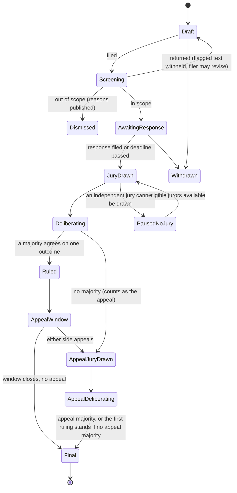

# Henge communities: specification

**Status:** approved by Rex on 2026-11-25, with his answers to the open questions folded in (section 11). Milestones C1
to C3 start after M7; C4 waits for G2 and legal sign-off.

**Scope:** the community layer the verafy.ai home page sells: founding a Henge, the Constitution, the Conclave, the
Judiciary, credits inside a Henge, the Treasury and paid app access, and teams, profiles and badges. It sits on top of
`docs/SWARM-EXPLORER-SPEC.md` (the node, store, scheduler, verification and ledger) and reuses what fits from
`docs/history/swarmstarter/` (the creator wizard, the judge flow, the determinism rules in SPEC 19A.3, and the stage
and treasury state machines), brought under Henge's rules.

**Rules that bind every section:**
- Never claim more than is real. Anything here that is not built says "later" wherever it is shown.
- No token, ever. No on-chain claims unless and until stamping is actually built. Records are a hash chain in Postgres
  and are labeled **Hash-chain record**, never "on chain" (history SPEC 19A.4).
- Credits are earned, never bought. No transfers between members, no cash-out of earned credits.
- The 20% platform fee (DECISIONS, pricing v1) applies to Swarm App revenue before any split.
- All numbers below are Rex's approved defaults (2026-11-25). Nothing here is a measured result.

---

## Contents

1. Terms
2. What a Henge is in the data model
3. Founding a Henge (`/found`)
4. The Constitution
5. The Judiciary
6. Credits inside a Henge
7. The Treasury and paid app access
8. Teams, profiles and badges
9. APIs
10. Site copy this spec changes
11. Rex's answers
12. Milestones C1 to C4

---

## 1. Terms

| Term | Meaning |
|---|---|
| Henge | A community that owns one or more swarms and is governed by a Constitution. |
| Conclave | The Henge's members. Membership is per account, not per node. |
| Constitution | The Henge's rules: structured clauses plus plain text. The site also calls it the charter. |
| Version | One immutable, ratified text of the Constitution. Every version is kept. |
| Swarm App | A swarm the Henge publishes. Its paid access is the Henge's revenue (C4). |
| Case | A dispute filed with the Judiciary. |
| Jury | The panel of AI jurors drawn for one case. |
| Juror | One seat on a jury: one node, running one model, owned by one account. |
| Contribution record | A verified entry saying a member did a piece of work for the Henge. |
| Treasury | The Henge's credit account, and later its dollar balance (C4). |

---

## 2. What a Henge is in the data model

### 2.1 Relationship to existing tables

A Henge is a new top-level object. It reuses the existing tables rather than replacing them:

- **Publisher.** Each Henge gets a `publishers` row (`kind = 'henge'`). Its swarms go through the same review,
  signing, revocation and kill-switch pipeline as any curated publisher (SPEC 6, 15). Until open publishing (M12),
  Rex reviews every Henge swarm, as for any swarm.
- **Swarms.** `swarms.henge_id` (nullable) links a swarm to the Henge that owns it. A swarm belongs to at most one Henge.
- **Memberships.** The existing `memberships` table stays node-level: it says which node works on which swarm and its
  share (SPEC 7.1). Conclave membership is account-level and lives in `henge_members`. Passing a qualification on any
  of the Henge's swarms makes the account eligible to enter the Conclave (the site's "Pass the trial and enter the
  Conclave"). People who contribute by hand (code, art, writing, testing) enter by an accepted contribution instead.
- **Ledger.** The Treasury is a `credit_accounts` row with a new `owner_type = 'henge'`. Every movement is a normal
  double-entry `ledger_entries` row with new movement types (section 6.4). Nothing bypasses the ledger.
- **Teams and badges.** Reused from M10 (section 8).

### 2.2 New tables

| Table | Purpose | Key columns |
|---|---|---|
| `henges` | The community | `id`, `slug`, `name`, `purpose`, `category`, `publisher_id`, `status` (`draft`, `ratifying`, `in_review`, `listed`, `paused`, `closed`), `current_version_id`, `community_url` (optional external link, 8), `created_at` |
| `henge_members` | The Conclave | `henge_id`, `account_id`, `status` (`active`, `left`, `removed`), `entry_basis` (`founder`, `qualification`, `contribution`), `entry_ref`, `joined_at`, `left_at`, `accepted_version_id` |
| `henge_roles` | Roles a Constitution defines | `henge_id`, `key`, `display_name`, `permissions` (from the fixed permission list in 2.3) |
| `henge_role_grants` | Who holds a role | `henge_id`, `account_id`, `role_key`, `granted_by_ref` (a decision or the founding), `granted_at`, `revoked_at` |
| `constitution_versions` | Every version | `id`, `henge_id`, `number`, `clauses` (JSONB, schema in 4.2), `text` (Markdown), `content_hash`, `prev_hash`, `status` (`draft`, `checked`, `ratifying`, `ratified`, `superseded`, `failed`), `ratified_at` |
| `constitution_checks` | The pre-signing jury check | `version_id`, `case_id`, `findings` (JSONB), `acknowledged_by`, `acknowledged_at` |
| `signatures` | Founding and ratification signatures | `version_id`, `account_id`, `device_signature`, `signed_at` |
| `proposals` | Decisions the Conclave votes on | `id`, `henge_id`, `kind` (typed, 4.5), `action` (typed JSON), `action_hash`, `status`, `opens_at`, `closes_at`, `version_id` (rules in force) |
| `votes` | One per member per proposal | `proposal_id`, `account_id`, `choice`, `weight`, `cast_at` |
| `cases`, `case_filings`, `juries`, `jury_seats`, `juror_votes`, `rulings` | The Judiciary | Section 5 |
| `contribution_records` | Section 6.1 | `id`, `henge_id`, `account_id`, `kind`, `ref`, `verification_ref`, `credits_awarded`, `status` |
| `bounties`, `bounty_claims` | Section 6.2 | |
| `revenue_events`, `revenue_splits` | Section 6.5 (C4 for dollars; credits earlier) | |
| `henge_events` | Append-only decision log, hash-chained per Henge | `henge_id`, `seq`, `kind`, `payload`, `payload_hash`, `prev_hash` |

`henge_events` is the Henge's public record ("a public record of what each member has done"). Each row hashes its
canonical payload and links to the previous row under a per-Henge lock, so the log cannot fork (history SPEC 19A.4).
It is tamper-evident relative to the copies members have seen, not tamper-proof against the database owner. The UI
says **Hash-chain record**.

### 2.3 Roles and permissions

A Constitution can name any roles, but each role is a set of permissions from this fixed list, so code can check them
deterministically:

| Permission | Allows |
|---|---|
| `propose` | Open a proposal (default: every member) |
| `post_bounty` | Post a bounty up to the Constitution's cap |
| `accept_contribution` | Accept a hand contribution as verified (needs two holders who are not the contributor) |
| `manage_swarm` | Submit a swarm release for Verafy review on the Henge's behalf |
| `moderate` | Hide content in Henge spaces pending a ruling (safety action, reviewable) |
| `admit` | Admit a member whose entry the Constitution leaves to a role (invite-only Henges) |

No permission can move Treasury credits outside a passed proposal, a bounty payout, a jury-duty payment or a revenue
split, and none can edit the Constitution. There is no owner role. The founder is a member with whatever roles the
first version grants.

---

## 3. Founding a Henge (`/found`)

The site's `/found` page is a placeholder today. The real flow lives in Henge web and the desktop app, signed in.

### 3.1 Steps

1. **Name and purpose.** Name (unique, checked against existing Henges and reserved words), one-line purpose,
   category (the site's seven: Gaming, Media, Math, Science, Security, Public Goods, Crypto), and a longer description.
   Prompt Guard screens all text (5.7).
2. **Template.** Pick a starter template (4.3) or start blank. The template fills the structured clauses.
3. **Constitution.** Edit the clauses in a form, with the plain text beside it. Required clauses cannot be removed.
   Locked platform clauses are shown but not editable (4.2).
4. **Pre-signing check.** A jury reviews the draft for gaps and contradictions (4.6). The founder must acknowledge every
   finding, by fixing it or by writing why it stays, before anyone can sign.
5. **Founding signers.** The founder invites co-founders (0 to 9 others). Each signs the exact version hash
   from their own device. Signing requires a verified Verafy account.
6. **Ratification.** Version 1 is ratified when every founding signer has signed within the ratification window
   (7 days). If the window passes, the draft returns to editing and nothing is published.
7. **Review and listing.** Until open publishing (M12), Rex reviews every Henge before it lists (the same curated rule
   as swarms). A listed Henge shows its Constitution, Conclave and Treasury pages. Its first swarm is a separate release
   through the normal swarm review.
8. **First members.** Founding signers are the first Conclave. Others join by passing a qualification on one of the
   Henge's swarms, or by an accepted contribution, as the Constitution says.

### 3.2 What founding never does

- It does not charge anything. There is no fee to found a Henge.
- It does not create credits. A new Treasury starts at zero.
- It does not let a founder buy rank, votes or a larger split.

### 3.3 Reused from SwarmStarter

The SwarmStarter creator wizard (history SPEC 6.16: left stepper, autosave, validate on Continue, jump to completed
steps) is the pattern. Its crowdfunding steps (stages, funding goals, governor model choice) are dropped.

---

## 4. The Constitution

### 4.1 Principles

- A Constitution is structured clauses plus plain text. Code enforces the structured clauses. The plain text explains
  them and covers what code cannot, and jurors read both.
- A ratified version is immutable. Changing anything means a new version, amended by the procedure in the old one.
- Every version is kept and linked by hash. A case is judged against the version in force when the disputed event
  happened (the site's promise).
- A member who does not accept a new version can leave and keeps every contribution record and credit already earned.

### 4.2 Clause schema

`constitution_versions.clauses` is validated against a JSON Schema (`henge-constitution-v1`) in `packages/schema`.

| Clause | Required | Structured fields | Notes |
|---|---|---|---|
| `purpose` | Yes | `summary`, `category` | |
| `membership` | Yes | `entry`: `qualification` / `contribution` / `admit`; `exit`: always allowed | Leaving can never forfeit earned credits or records. |
| `roles` | Yes | list of `{key, display_name, permissions[]}` | Permissions from 2.3 only. |
| `decisions` | Yes | `voting_weight`: `one_member_one_vote` or `contribution_weighted` (with `cap_bp`); `quorum_bp`; `threshold_bp`; `discussion_hours`; `voting_hours` | Pass uses For / (For + Against); abstentions count for quorum only (history 19A.3). Weight can never come from spending. |
| `revenue_split` | Yes | list of `{recipient: contributors / treasury / role:<key>, bp}` summing to 10,000; `contributor_basis`: `credits_earned_in_period`; `period`: `month` | Applies to what remains after the platform fee (6.5). |
| `bounties` | Yes | `max_bounty_credits`, `who_can_post` (role), `needs_proposal_above` | |
| `jury_pay` | Yes | `credits_per_ruling` | Paid from the Treasury (6.3). May be 0. |
| `treasury_spend` | Yes | allowed purposes from a fixed list: `bounties`, `jury_pay`, `compute`, `revenue_split` | No purpose can pay a member outside these. |
| `disputes` | Locked | Cases go to the Henge Judiciary; one appeal; the jury rules on this version's text | Platform clause, not editable. |
| `amendment` | Yes | `quorum_bp`, `threshold_bp` (must be stricter than `decisions`), `voting_hours`, `who_can_propose` | |
| `platform` | Locked | 20% platform fee; no transfers; no cash-out; no token; Verafy's kill switch and review apply | Platform clause, not editable. |
| `custom` | No | free text only | Jurors read it; code does not enforce it. |

Validation rules code enforces on every draft: splits sum to 10,000 basis points; amendment thresholds are stricter
than ordinary ones; every role referenced exists; locked clauses are byte-identical to the platform copy.

### 4.3 Starter templates

Each template is a full, valid set of clauses with plain text. The numbers are template defaults the founder can change.

| Template | Entry | Voting | Example split after the fee | Notes |
|---|---|---|---|---|
| Research collective | Qualification | One member, one vote; quorum 10%; pass over 50% | 60% contributors, 25% treasury, 15% maintainers role | Adds an open-results clause: accepted results are published under an open license. |
| Open-source tool | Qualification or contribution | Contribution-weighted, capped at 5% per member | 70% contributors, 30% treasury | Adds a license clause and requires two reviewers to accept a code contribution. |
| Game studio | Contribution or admit | One member, one vote | 60% contributors, 25% treasury, 15% founders role | Adds an original-assets clause: no third-party names, marks or assets; a license file per asset (from the SwarmStarter Game Mod template). |
| Grant fund | Admit | One member, one vote; quorum 20%; pass over 60% | 10% contributors, 90% treasury | Adds a conflict clause: members cannot vote on grants to themselves. |

The 60/25/15 split is the one the site already shows as an example. All template splits are labeled examples in the UI.

### 4.4 Ratification and amendment

- **Founding (version 1):** every founding signer signs (3.1).
- **Amendment (version n + 1):** a member with the right permission opens an `amendment` proposal containing the full
  new version. The new version must pass the pre-signing check (4.6) before voting opens. Voting follows the
  `amendment` clause of version n, not of the new version. If it passes, version n + 1 is ratified and version n becomes
  `superseded`. Deterministic code checks quorum, threshold, eligibility (members at the moment voting opened) and
  deadlines before anything changes (history 19A.3).
- **No retroactive loss.** An amendment cannot reduce credits already earned, contribution records already accepted, or
  splits for revenue already received. It applies from the next split period.
- **Members who disagree** can leave with everything they earned (4.1). Members see the diff of every version.

### 4.5 Proposals

Typed kinds, so the executor never guesses: `amendment`, `bounty` (above the clause cap), `treasury_spend`,
`role_grant`, `role_revoke`, `admit`, `remove_member`, `swarm_release` (ask Verafy to review a new release),
`close_henge`. Each carries a complete typed `action` whose canonical hash is what members vote on.

### 4.6 The pre-signing check

Before a version can be signed or voted on, a jury (drawn as in 5.4, with the same size as a first jury) reads the
draft and returns findings of three kinds: **gap** (a situation no clause covers, for example how a removed member's
pending bounty is handled), **contradiction** (two clauses that cannot both hold), **unclear** (wording a juror could
read two ways). Findings are advisory. The jury cannot block a version. Signers must acknowledge each finding (fix it or
record why it stays), and the acknowledgements are kept with the version.

The structured-clause validation in 4.2 is code and is not advisory: an invalid draft cannot be signed.

### 4.7 What the Constitution is not

It is not a legal contract, and the UI says so. It does not grant ownership of anything, and it cannot promise
dollars before C4.

---

## 5. The Judiciary

### 5.1 What it decides

Disputes inside one Henge about things the Constitution governs: whether a contribution was credited correctly,
whether a role holder acted within their permissions, whether a decision followed the procedure, whether a split was
computed correctly, whether a member was removed fairly. It does not decide anything outside the Constitution,
anything about another Henge, or anything Verafy's review and kill switch cover (malware, illegal content, platform
abuse). Those go to Verafy's existing reports and review path (SPEC 15).

### 5.2 Case lifecycle

1. **Filing.** Any Conclave member, or a former member within 30 days of leaving for disputes about
   their own contributions, files a case: which clause, what happened, what outcome is sought (a typed remedy, 5.6),
   and evidence (text and files). One open case per filer per Henge at a time. No deposit, because
   credits cannot be bought and a deposit would price out new members.
2. **Response.** The other side (a member, a role holder, or the Henge itself, answered by whoever holds the relevant
   role) has a deadline to respond with its own evidence: 72 hours, which a Constitution can set between
   24 hours and 7 days.
3. **Jury draw.** Section 5.4.
4. **Rulings.** Each juror rules on its own, against the version in force when the disputed event happened, and gives
   reasons that cite clauses.
5. **Majority outcome.** Section 5.5.
6. **One appeal.** Either side can appeal once within 72 hours of the ruling. The appeal jury is larger and
   drawn fresh, with no juror from the first jury. Its ruling is final.

### 5.3 Jury sizes

| Jury | Jurors | Majority | Why |
|---|---|---|---|
| First jury | 5 | 3 | The SwarmStarter judge panel size; odd, small enough to draw from a curated alpha pool. |
| Appeal jury | 9 | 5 | Larger than the first jury, as the site promises; still odd. |
| Pre-signing check | 5 | Not a vote | Findings are pooled, not voted. |

Once Rex approves these, the site's Judiciary section states them (Part A, item 5).

### 5.4 Who can sit on a jury, and how the draw works

**Eligible jurors:** nodes that have passed the `verafy-juror` qualification, are online, have a model from the
curated catalog with a known family and maker, and whose owner account is not a member of the Henge in the case, not a
party, and has no open case of its own in that Henge. ("Rigs with no ties to either side.")

**Panel rules (spread across makers and operators):**
- Every juror is owned by a different account (operator).
- No more than 2 jurors share a model family on a first jury, and no more than 3 on an appeal jury.
- At least 3 different model makers sit on every jury.
- If those rules cannot be met, the case pauses as **Paused: no independent jury** and says so. The draw never quietly
  weakens the rules (history 19A.3).

**The draw anyone can check:**
1. When the response deadline passes, Henge web freezes and publishes the **eligible pool snapshot**: every eligible
   node's public id, model family and maker, and operator hash, sorted, with its hash.
2. The draw seed is `SHA-256(case_id || pool_snapshot_hash || beacon_value)`, where `beacon_value` is the first value a
   drand mainnet beacon publishes after the snapshot is frozen. Nobody, including Verafy, knows the beacon value when the pool is frozen.
3. The seed drives a published, deterministic algorithm: rank every eligible node by `SHA-256(seed || node_id)`, then
   walk the ranking and seat each node that keeps the panel rules satisfied, until the jury is full.
4. The ranking continues past the last seat. If a juror times out (30 minutes per ruling), the next valid node
   in the ranking takes the seat, so replacements are also checkable.
5. The draw record (snapshot, beacon round and value, seed, ranking, seated jurors, replacements) is published with the
   case. A small open-source script in the repo recomputes it.

This is the "publishes how every jury is drawn" line on the site, made concrete.

### 5.5 How a ruling is reached

- Each juror returns JSON: `{ outcome, remedy, clauses_cited[], reasons }`. Clause ids are validated against the
  version; a ruling citing a clause that does not exist is rejected and the juror re-asked once.
- Outcomes are compared as a **complete typed remedy**, by the hash of the canonical remedy (history 19A.3). Two jurors
  who both "uphold" but name different remedies do not agree.
- **Majority:** 3 of 5 on the same remedy hash (5 of 9 on appeal). If no remedy reaches a majority on a first jury, the
  case goes straight to the appeal jury and that counts as the one appeal. If the appeal jury has no majority, the status
  quo stands and the record says so.
- Juror outputs are published with the ruling. The site's line "The ruling is published to the whole Conclave with its
  reasons" is the default visibility. A Constitution can make rulings public. Draw records are always public.

### 5.6 Remedies the executor can carry out

Typed and limited, so a ruling can only do what code can check: `credit_contribution` (accept or correct a contribution
record), `reverse_treasury_action` (credits only, only for actions not yet final), `restore_member`, `revoke_role`,
`void_vote` and `rerun_vote`, `recompute_split` (for the disputed period), `no_action`. A ruling can never amend the
Constitution, move credits between members directly, or touch dollars. Safety actions (hiding content, pausing a node)
can happen at once through Verafy's existing tools and remain reviewable.

### 5.7 Prompt Guard on every filing

Every filing, response, piece of evidence text and juror input passes through Prompt Guard (the vendored
`Verafyai/prompt-guard`, from M7) before any model sees it. Party text is always given to jurors as quoted data,
never as instructions (the site's "Evidence is treated as evidence, never as orders"). A flagged passage is withheld from
jurors and replaced with a notice; the filer sees which passage and can revise. The screening verdict and Prompt Guard
version are stored with the case.

### 5.8 Jury duty

Jury seats run on members' rigs as a swarm (`verafy-dao-juries`, already a launch swarm), so jury work is ordinary
leased tasks, verified by the jury method (SPEC 8). A juror whose rulings are returned malformed or late loses
reputation, as in SPEC 8. Jury pay is in 6.3.

### 5.9 Integration with judiciary.verafy.ai

Verafy Judiciary at judiciary.verafy.ai is the same AI-jury idea, already live as a separate product. Henge reuses its
juror prompts and output format where they fit. In C3 the integration is **links only**: Henge runs its own jury on the
`verafy-dao-juries` swarm and links to judiciary.verafy.ai. A shared API is revisited after C3.

---

## 6. Credits inside a Henge

### 6.1 Contribution records

A contribution record says a member did a piece of work for the Henge. Kinds:

| Kind | Verified by |
|---|---|
| `swarm_task` | The swarm's verification method (SPEC 8). Created automatically from accepted results. |
| `hand` | Two holders of `accept_contribution` who are not the contributor, with a link to the work. |
| `bounty` | The bounty's acceptance (6.2). |
| `jury` | An accepted jury ruling (6.3). |

Records are append-only; corrections are new records, often from a ruling. Every record is visible to the Conclave
("a public record of what each member has done").

### 6.2 Bounties

The Treasury posts jobs. A bounty has a description, an acceptance rule, a credit amount and a deadline. Posting
reserves the credits from the Treasury (`bounty_reserve`). A member claims it, delivers, and the role named in the
Constitution accepts (or a proposal does, above the cap). Acceptance pays the reserved credits (`bounty_pay`); expiry
or cancellation releases them (`bounty_release`). Disputes go to the Judiciary.

### 6.3 Jury-duty pay

The Constitution's `jury_pay.credits_per_ruling` is paid from the Henge's Treasury to each juror account whose ruling
was accepted (`jury_pay`). If a Henge's Treasury cannot cover a case's jury pay, the case still runs, and jurors earn
impact only for that case.

### 6.4 Where a Henge's credits come from

This is where the site and the current spec must agree. SPEC 9.1 says volunteer swarms award impact only, so no swarm
can print spendable credits. This spec keeps that rule. A Henge's Treasury receives credits only from:

1. **Funded swarm work (from M9).** When a publisher's funded pool pays for accepted tasks on a Henge's swarm, the
   credits go to the members who did the work, as today. A Constitution can route a share to the Treasury instead.
2. **Paid app access (C4).** Revenue from the Henge's Swarm App, after the platform fee, in dollars, after G2 and legal.

Until M9, a Henge's Treasury is empty and its members earn impact and contribution records, not credits, unless they
work on a funded swarm. The site says so (section 10).

New ledger movement types: `henge_inflow`, `bounty_reserve`, `bounty_release`, `bounty_pay`, `jury_pay`,
`split_pay`, `treasury_spend`. All are double-entry, idempotent and checked by the existing reconciliation.

### 6.5 The revenue split under the 20% platform fee

For each split period (default: calendar month) and each Swarm App:

1. `gross` = revenue received in the period (credits until C4; dollars in C4).
2. `fee = floor(gross × 2000 / 10000)` goes to Verafy. The 20% is the platform fee in DECISIONS (pricing v1). Rounding is
   down, in the members' favor.
3. `remaining = gross - fee`.
4. Each split line gets `floor(remaining × bp / 10000)`.
5. The **contributors** line is divided among members in proportion to the credits each earned in that Henge in the
   period (`contributor_basis`), again rounding down.
6. Rounding leftovers go to the Treasury, so every unit is accounted for and the computation is deterministic.
7. The split is published to the Conclave with every input before it pays, and pays after a 72-hour
   window in which any member can file a case. A case freezes the split for that period only.

Worked example (example numbers only): gross 10,000 credits; fee 2,000; remaining 8,000; with the 60/25/15 example
split: contributors 4,800, treasury 2,000, the 15% role 1,200. If the contributors earned 300, 200 and 100 credits that
month, they receive 2,400, 1,600 and 800.

---

## 7. The Treasury and paid app access

### 7.1 First version: ledger only, in credits

The Treasury is a credit account with glass walls: every member sees every movement in and out, with its reason and
the decision that authorized it ("Every payment in and out is visible to every member"). Spending happens only for
the purposes in the `treasury_spend` clause, through bounties, jury pay, splits, or a passed `treasury_spend` proposal.
There is no withdrawal, no transfer to a member outside those paths, and no cash-out.

### 7.2 Dollars (C4, after G2 and legal sign-off)

Paid app access means outsiders pay dollars to use a Henge's Swarm App. That requires collecting money, holding it for
a community, and paying people, which needs legal sign-off. Two options for Rex to compare:

| | Fiscal host | Stripe Connect payouts |
|---|---|---|
| What it is | A nonprofit or company that legally holds each Henge's money and pays out on its instructions | Verafy collects through Stripe and pays members through Stripe Connect connected accounts |
| Who holds the money | The fiscal host | Verafy, as the platform |
| Member onboarding | The host's process (tax forms, payee details) | Stripe's connected-account onboarding (identity, tax, bank) |
| Taxes and 1099s | The host handles reporting | Verafy's obligations, with Stripe tooling |
| Fees | The host's fee on top of Stripe's | Stripe's processing and Connect fees |
| Fit | Good for grant funds and public-goods Henges | Good for app revenue paid to many contributors |
| Lead time | A host agreement per Henge or umbrella | Stripe review of the platform model (history SPEC 19A.6) |
| Risk | Less control over payout timing | Verafy carries more compliance work |

Rex leans toward Stripe Connect, because Verafy already uses Stripe. The decision is made at C4, with legal. Either way: earned credits are never cashed out. Dollars paid to members come only
from the dollar revenue split, not from converting credits.

### 7.3 Never

No token, no transfers between members, no cash-out of earned credits, no buying credits, no speculation on a Henge's
"value", and no dollars before C4.

---

## 8. Teams, profiles and badges

Reused from M10 where they overlap:

- **Profiles** (M10) gain a Henges section: Conclave memberships, roles, accepted contributions, and juries served on
  (case ids only, not how the juror ruled, unless the case is public). Private by default, as M10 requires.
- **Community link.** A Henge's profile can show one optional external community link (Discord or similar),
  `henges.community_url`, validated as https and screened by Prompt Guard. Henge has no chat of its own, and chat is
  not a milestone.
- **Teams** (M10 `teams`) stay separate from Henges. A team can join a Henge's swarms together; Conclave membership is
  still per account.
- **Badges** (M10 `badges`) add a nullable `henge_id` for Henge-specific badges (for example "First ten
  contributions"), awarded only for verified records. Leaderboards rank contribution, never spending, as the site says.

---

## 9. APIs

Added to SPEC 13 under `/v1`, with the same auth, idempotency and error rules.

| Method | Path | Notes |
|---|---|---|
| GET | `/v1/henges`, `/v1/henges/{slug}` | Listed Henges |
| POST | `/v1/henges` | Create a draft (founder) |
| PUT | `/v1/henges/{id}/constitution/draft` | Validates against `henge-constitution-v1` |
| POST | `/v1/henges/{id}/constitution/draft/check` | Starts the pre-signing check |
| POST | `/v1/constitution-versions/{id}/acknowledgements` | Acknowledge findings |
| POST | `/v1/constitution-versions/{id}/signatures` | Device-signed |
| GET | `/v1/henges/{id}/constitution/versions`, `/versions/{n}`, `/versions/{n}/diff` | Every version |
| GET/POST | `/v1/henges/{id}/members` | Join (eligibility checked), leave |
| GET/POST | `/v1/henges/{id}/proposals`, `PUT /v1/proposals/{id}/vote` | Typed proposals |
| GET/POST | `/v1/henges/{id}/cases`, `POST /v1/cases/{id}/response`, `POST /v1/cases/{id}/appeal` | Judiciary |
| GET | `/v1/cases/{id}/draw` | The full draw record (public) |
| GET/POST | `/v1/henges/{id}/bounties`, `POST /v1/bounties/{id}/claims` | |
| GET | `/v1/henges/{id}/treasury`, `/treasury/ledger`, `/splits/{period}` | Visible to members |
| GET | `/v1/henges/{id}/events` | The hash-chained decision log |

---

## 10. Site copy this spec changes

Approved by Rex (2026-11-25), shipped in one verafy-website PR after #83, with tests in `henge.test.ts`:

1. The Judiciary section states the jury sizes and panel rules: 5 jurors with a majority of 3; one appeal to 9 jurors
   with a majority of 5; jurors from at least 3 makers, no more than 2 sharing a model family (3 on appeal).
2. The Constitution card: "Nobody changes them without the vote your Constitution requires, and you always leave with
   what you earned."
3. "Run the Henge chat and set roles" drops chat. A Henge can link to its own community instead.
4. "Earn credits for rig time and work by hand" becomes "Earn impact and a record of every contribution. Credits arrive
   with funded swarms."

---

## 11. Rex's answers (2026-11-25)

1. **Credits before M9:** accepted. Members earn impact and contribution records until funded pools exist (6.4).
2. **Chat:** dropped from the site. A Henge's profile gets an optional external community link (8). Not a milestone.
3. **Jury pay with an empty Treasury:** impact only (6.3).
4. **Randomness:** drand (5.4).
5. **judiciary.verafy.ai:** links only in C3, with the jury on the `verafy-dao-juries` swarm. Revisit a shared API after
   C3 (5.9).
6. **Treasury dollars:** lean toward Stripe Connect; decide at C4 with legal (7.2).
7. **Numbers:** all approved: jury 5 and appeal jury 9, majorities 3 and 5; family caps 2 and 3, at least 3 makers;
   72-hour response, appeal and split windows; up to 9 co-founders; 7-day ratification window; former members may file
   for 30 days; one open case per filer.
8. **Listing review:** Rex reviews every Henge before it lists, until M12.

---

## 12. Milestones C1 to C4

Same style as SPEC 16.4. Each ends with local or test-environment demos and passing CI. No deployment, real money or
outside contact without Rex's separate approval.

| ID | Name | Scope | Acceptance criteria |
|---|---|---|---|
| C1 | Henges and Conclaves, no money | `henges`, `henge_members`, roles and permissions, `publishers.kind = 'henge'`, `swarms.henge_id`, Henge pages in Henge web and the app with the optional community link, join and leave, contribution records from accepted swarm tasks and hand contributions, the hash-chained `henge_events` log, Treasury account at zero, Henge sections on profiles | A member enters the Conclave only by a passed qualification, an accepted contribution or an `admit` by a role holder; leaving keeps every record; a hand contribution needs two acceptors who are not the contributor; `henge_events` cannot fork under concurrent writes (test); no endpoint can create or move credits; the UI labels the log "Hash-chain record" and makes no on-chain claim |
| C2 | Constitutions | `henge-constitution-v1` schema, the four templates, the `/found` flow (name to listing), the pre-signing jury check, device signatures, ratification, typed proposals and voting, amendment by the old version's clause, version history and diffs | Invalid drafts cannot be signed (splits not summing to 10,000, amendment thresholds not stricter, edited locked clauses: each a test); every finding must be acknowledged before signing; version 1 ratifies only with every founding signature in the window; an amendment that passes under version n's rules but would fail under version n + 1's is still ratified (and the reverse fails); no amendment can reduce earned credits or accepted records (test); every version stays readable |
| C3 | Judiciary | Cases, responses, Prompt Guard screening of every filing, eligible pool snapshots, the beacon-seeded draw with panel rules, juror tasks on the `verafy-dao-juries` swarm, typed remedies and the executor, majority by remedy hash, one appeal to a larger fresh jury, pausing when no independent jury exists, published draw records and the recompute script, Conclave-visible rulings with reasons, jury pay from the Treasury when funded | The recompute script reproduces every test draw exactly; no seated juror belongs to the Henge, a party or a shared operator; family and maker rules hold or the case pauses with that reason; flagged filing text never reaches a juror (red-team fixtures); a ruling citing a non-existent clause is rejected; two jurors with different remedies do not form a majority; an appeal jury never reuses a first-jury node; the executor refuses any remedy outside 5.6; the site's jury numbers match the approved spec (site test) |
| C4 | Treasury and paid app access (after G2 and legal) | Dollar revenue for Swarm App access through the option Rex chooses (7.2), the 20% platform fee, monthly revenue splits with the review window, payouts to members' verified payout accounts, Treasury dollar ledger visible to members | Requires G2 evidence and written legal sign-off before any real money; test mode until then. Split computation matches 6.5 exactly, including rounding, in property tests; a filed case freezes only that period's split; no path converts earned credits to dollars; reconciliation balances to the cent against the processor; kill switch stops payouts |

---

*All numbers are Rex's approved defaults (2026-11-25). Example amounts are examples, not results.*
