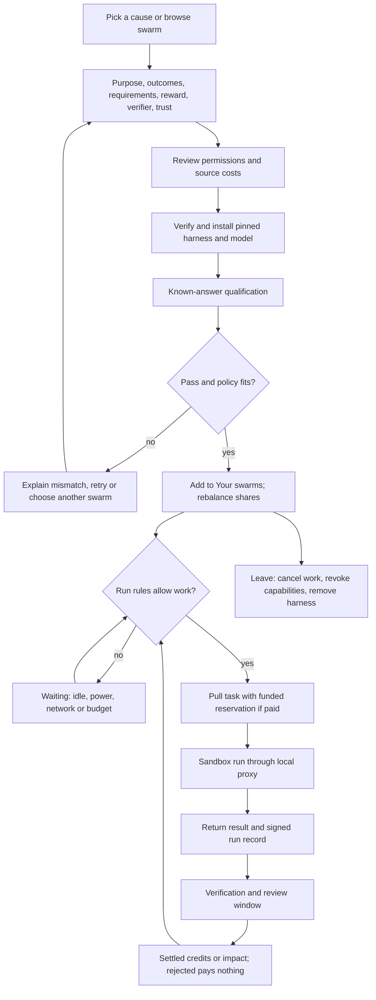
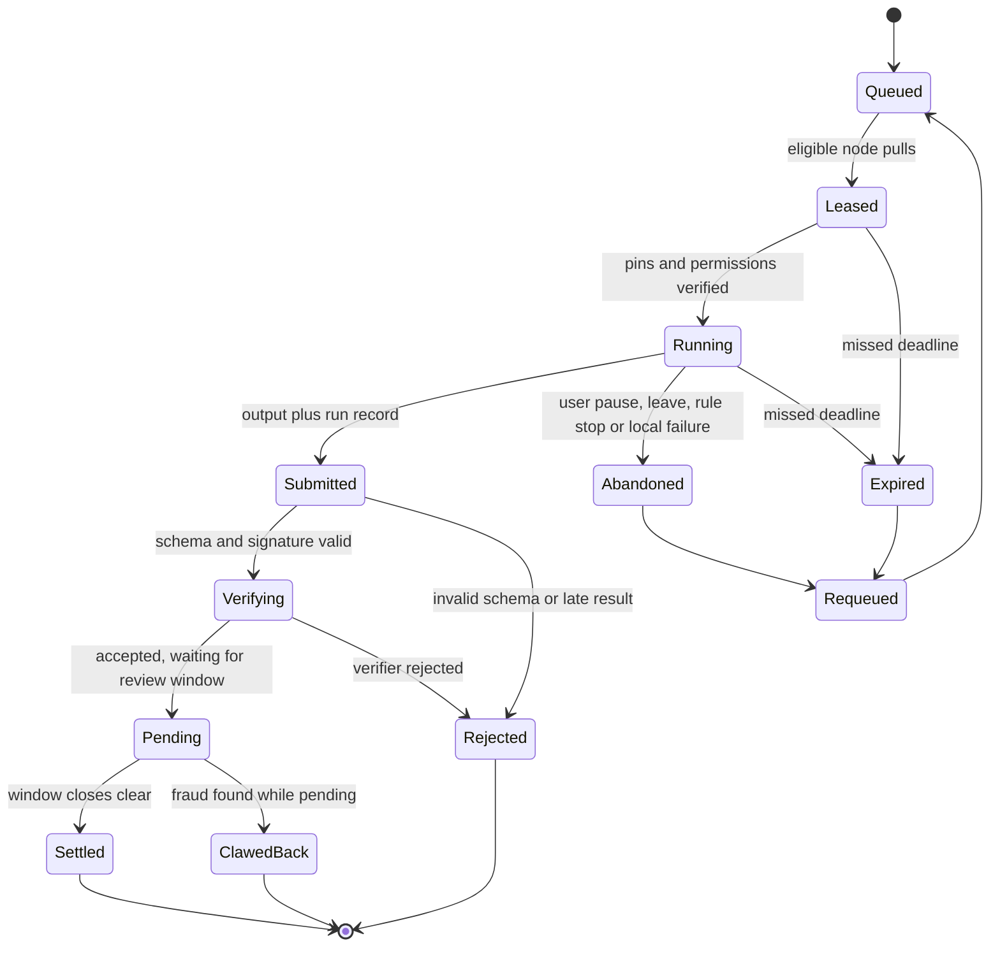
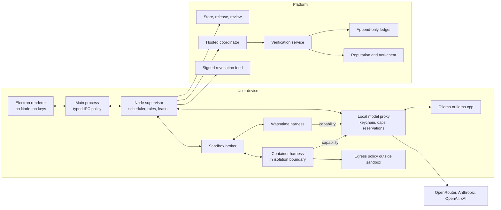

# Swarm Explorer: build-ready app specification

**Verafy | November 24, 2026 | Product owner: Rex St John**

**Status:** Implementation specification converted from Rex's pasted "Swarm Explorer: product spec" by @Ironchef. Swarm Explorer is the decided product name. This document is self-contained and supersedes the SwarmStarter product specification and client-first addendum for future Swarm Explorer work. The older files remain as history, not dependencies.

**Precedence:** Rex's supplied product decisions govern. This document supplies engineering contracts where his source leaves implementation unspecified. All rates, task quantities, model names, hardware sizes and manifests below are source examples or clearly labeled illustrations, not verified production availability, benchmarks, revenue or promises. Pricing and take rate remain proposals. No schedule dates or invented traction targets are assigned.

## Contents

1. Product, scope and decisions
2. Concepts, roles and permissions
3. User journeys
4. Information architecture and screen contracts
5. Node setup, compute sources and model catalog
6. Harness and swarm packaging
7. Scheduler, timeshare and task lifecycle
8. Verification, reputation and anti-cheating
9. Credits, funding pools and economic contracts
10. Publisher tools, SDKs and coordinators
11. Architecture and security boundaries
12. Data model and schemas
13. APIs and events
14. Impact, teams, privacy and notifications
15. Distribution, operations and failure handling
16. Launch swarms, open questions and gated milestones
16A. Risks
17. Test plan and Claude Code execution instructions
18. Migration from SwarmStarter and deferred scope

---

## 1. Product, scope and decisions

### 1.1 Summary

Swarm Explorer is an app store for swarms. Install one node, connect a local model or an API key, and give its time to the causes you choose. Each swarm is an app with a purpose, such as DAO juries, Lean proofs, medical literature review or game AI. Nodes earn credits for verified work in funded swarms and spend credits on their own jobs. Volunteer swarms earn impact only.

This is a two-sided marketplace: publishers fund pools and publish work; contributors run nodes that join swarms, pull tasks and return results; verified accepted results move credits from the publisher's prepaid pool to pending and then settled contributor balances. The platform does not sell generic tokens-per-second or promise income.

One install, many causes, one credit account. Publishers get diverse participants and verification rather than another inference API. Contributors get a library of causes, visible outcomes, bounded resource use and a balance usable within the network.

### 1.2 Positioning

The source places Swarm Explorer after SETI@home and Folding@home and after local runtimes such as Ollama and llama.cpp, and argues that agent harnesses, Lean checkers and Verafy jury work are what changed. The core-concepts diagram embedded in the source (node/366c23f2-3cf9) was not included in the paste; Section 11.1 supplies an engineering diagram instead.


Volunteer computing is the conceptual predecessor, local model runtimes and provider APIs supply the compute, and harnesses package the work. Deterministic checkers such as Lean can verify some outputs. Verafy's independent-model jury approach checks work that cannot be decided by a simple checker. Historical claims about participation scale or comparative compute records are not required for implementation and are not asserted as measured facts here.

### 1.3 Decided product rules

- Product name: **Swarm Explorer**. Branding: **Verafy**.
- Desktop-first client for macOS and Windows; Linux beta and a headless CLI are compatible extensions. Thin public website for discovery and downloads.
- Node modes: **Local**, **API key**, **Hybrid**. Local is the first-run choice on usable supported hardware; API availability is gated by provider terms.
- Catalogs: swarms, models and signed harnesses. No paid model/harness listings in the first release.
- Model policies: **Any**, **Class**, **Diverse**.
- Shares across joined swarms sum to **100%**; equal shares initially; work-conserving weighted fair scheduling.
- Local GPU concurrency defaults to **one task**. API concurrency is a user-controlled limit.
- Run defaults: idle for **5 minutes**, plugged in, not on metered networks, temperature throttle above **80 °C**, maximum CPU/GPU share **75%** where enforceable.
- **Pause abandons the running task immediately and returns it unpaid.** It never waits for a task to finish.
- Credits reward **verified output**, not compute time or merged commits. Every earned spendable credit originates in a publisher-funded pool.
- Impact is nonspendable. Volunteer swarms pay impact, not unbacked credits.
- Credits are not a token. No user-to-user transfers or cash-out in the first release. Donations to swarm pools are allowed.
- API keys stay in the OS keychain and never leave the device. Harnesses call a local proxy; they never receive keys.
- Harness sandbox, permissions, publisher signatures, listing review and kill switch are required in the first release.
- Profiles private by default. Weekly summaries off by default. Leaderboards rank impact only.
- Open publishing follows returning nodes and an outside security review. No launch phase has a date yet.

### 1.4 Engineering proposals, not new business decisions

The following stack is a recommended build default, not a decision supplied by Rex. Confirm hosting and database selection before provisioning. No services are created by this spec.

| Area | Recommended implementation | Rationale and boundary |
|---|---|---|
| Desktop | Electron, React, TypeScript, Vite | Keeps the prior client-first direction and a shared TypeScript node core. Pin maintained compatible versions at implementation time. |
| Website/API | Next.js on a separate Vercel project | Public store, model/harness metadata, results, verification, downloads and auth handoff. No deployment over www.verafy.ai. |
| Server data | Postgres/Neon, Drizzle, transactional outbox | Reliable leases, pool reservations and append-only ledger. |
| Local data | SQLite, OS-keychain-held encryption key | Offline library/cache/drafts. No provider keys in the database. |
| Local runtimes | Ollama adapter and llama.cpp adapter | Respect runtime management ownership; do not replace a user's existing install silently. |
| Harness execution | Wasmtime for pure logic; locked-down runtime containers inside an isolation boundary appropriate for hostile code | No native execution with the user's permissions. See Section 11 for VM-grade protection and capability mediation. |
| Host services | Isolated supervisor, scheduler, model proxy and sandbox broker | Renderer cannot directly access runtimes, credentials, arbitrary URLs or filesystem. |
| Protocol | HTTPS pull leases and signed result envelopes | No inbound connections to home nodes. |
| Hosted jobs | Durable job runner plus object storage | Verification, settlement windows, release review and kill-switch broadcasts. |
| Mobile | Later and optional companion: node status, Pause and notifications | Not in Rex's source spec. No local code execution or purchases. Not a first-release deliverable. |

---

## 2. Concepts, roles and permissions

### 2.1 Glossary

| Term | Definition | Source example |
|---|---|---|
| Node | One install on one machine; sources, models, settings and credit-account view | MacBook with Ollama and an OpenRouter key |
| Compute source | Local runtime or provider API | Ollama, llama.cpp, OpenRouter, Anthropic, OpenAI, xAI |
| Model | Weights for a local source or a provider model ID | Llama 3.3 70B, Qwen 2.5 Coder, Claude Sonnet; examples, not recommended current versions |
| Harness | Tools, prompts, loop, retries and output format surrounding a model | Lean proof-search harness or juror harness |
| Swarm | Published app with a purpose that sends tasks to joined nodes | DAO juries, Challenge Vaults, Prompt Guard red team |
| Task | Input, policy, limits, expected output and deadline | "Rule on this dispute" or "Try to prove lemma 14" |
| Verification | Work checks completed before settlement | Lean checker, jury, known answer, publisher review |
| Credit | Internal spendable unit earned from funded verified tasks | Source illustration: 12 credits for an accepted jury vote |
| Impact | Category-specific nonspendable recognition for verified accepted work | Checked proof steps or jury participation |
| Publisher | Person or organization operating a swarm and funding its pool | DAO, lab, security team or Rex |
| Coordinator | Service that leases tasks and manages submissions | Hosted service or registered publisher coordinator |
| Qualification | Short known-answer test required to access a swarm's paid tasks | Manifest illustration: pass 2 of 3 tasks |
| Account | Identity that owns installs and the spendable ledger balance | Multiple devices may display one account balance; installs do not mint independent balances |

### 2.2 Roles and permissions matrix

Y = permitted; own = own account/object; scoped = a project-specific grant; no = disallowed.

| Action | Public visitor | Contributor | Publisher member | Publisher owner | Verifier/juror | Platform reviewer/admin |
|---|---|---|---|---|---|---|
| Browse public store/results | Y | Y | Y | Y | Y | Y |
| Manage node/settings/keys | no | own | own | own | own | no access to another node's keys |
| Join/leave swarm | no | own | own | own | own | can halt unsafe swarm |
| Lease work | no | qualified, policy-matched | same | same | verifier-scoped assignments | no bypass of verification |
| Submit results | no | own active lease | same | same | own verification assignment | no forged contributor result |
| Fund/donate pool | no | own balance | scoped | Y | own balance | corrections only, audited |
| Publish release | no | no | scoped | Y | no | review/approve/reject |
| Set reward/verifier policy | no | no | scoped, future tasks | Y, future tasks | no | safety pause only |
| Accept/reject results | no | no | publisher-review scope only | publisher-review scope only | assigned verification only | adjudicate abuse/dispute, audited |
| Move account credits | no | purchases/jobs/donations only | same | same | earned via verification work | append-only correction with reason |
| Cash out or transfer to another user | no | no | no | no | no | no product path |
| Change trust/publisher badge | no | no | no | prove domain/org ownership | no | reviewed decision |
| Halt/revoke bundle | no | local leave/pause | own swarm pause | own swarm pause | report only | platform-wide kill switch |
| View private task content | no | assigned task only | scoped | own organization | assigned verifier only | least privilege support with audit |

Publishers cannot self-certify a result into spendable balance by posting an arbitrary "accepted" webhook. Verifier authority, funding reservation and ledger validation are distinct services.

---

## 3. User journeys

### 3.1 One-click start: Pick a cause

The first useful screen is **Pick a cause**, not a complex runtime settings page.

1. Choose a category: Governance, Mathematics, Security, Science, Healthcare, Public goods or Gaming.
2. Show that category's featured swarm with its purpose, verifier, required permissions and any real API costs. One tap can select it, but cannot bypass consent to executable code, downloads or API spending.
3. Detect hardware and installed runtimes/models. Local is selected when a suitable GPU or Apple Silicon is present. If no source can satisfy policy, explain the mismatch and offer another swarm or gated API setup.
4. Recommend a qualifying model that fits and show download size, license, disk budget and the fit estimate. Confirm download; verify hashes; benchmark after install.
5. Install the reviewed signed harness, approve its declared permissions, qualify and join.
6. Show the task queue. If idle/power/network rules currently prevent work, say "Ready, waiting for your run rules," not "working."
7. After verified work show a concrete result and either pending credits or impact only. Never display income projections.

### 3.2 Join, give time and leave



On Leave, stop local work immediately, abandon leases, remove the harness reference and its private scratch data. Shared harness/model artifacts remain only if another joined swarm needs them or the user explicitly retains them. Credits already earned remain. Late submissions from abandoned work are not rewarded.

### 3.3 API or Hybrid setup

- Explain real provider costs and that credits cannot be cashed out.
- Offer OpenRouter, Anthropic, OpenAI and xAI adapters only when the terms gate permits that provider and mode.
- Save key to OS keychain, test with the smallest supported request (the source's one-token call where supported), show that even a test can incur cost.
- Require global daily/monthly, per-swarm and per-task dollar ceilings before enabling API tasks. No default unlimited API spending.
- Hybrid uses local for eligible work. Only policy-required work that cannot run locally can use API, under prior explicit per-swarm consent. Never silently fall back to paid API after a local error.

### 3.4 Publisher: write, test, fund, submit

1. Create publisher identity; prove control of a domain or GitHub organization for Verified badge (ownership, not endorsement).
2. Draft manifest and harness, schema and verifier. Select hosted or registered self-hosted coordinator.
3. Run `swarm dev` against sample tasks and local sources; inspect permissions, schema validation, limits, verification and expected receipts.
4. Choose volunteer impact-only mode or fund a prepaid pool. For paid work define reward, pending verification window, review policy, verifier-cost budget and task deadlines.
5. `swarm publish` signs the content-addressed release and submits for review. Publishing is curated initially.
6. Reviewers inspect code, domains, verifier determinism/quality, permissions, model policy, licensing and economic disclosures. No open publishing before the external security gate.
7. An approved listing becomes discoverable; qualification and task leasing start only for eligible consenting nodes.
8. Dashboard shows queue, eligible/active nodes, verification backlog, accepted/rejected results, credits reserved/pending/settled, cost per accepted result and reports.

### 3.5 Spend earned credits

Open Wallet > Run a job, choose an existing swarm/service or create a publisher task batch, review reward/verifier budgets and confirm. Credits reserve from the account into the job pool, tasks run, and only verified accepted work settles. Unused unreserved pool credits can return to the funding account under policy; this is not user-to-user transfer or cash-out.

---

## 4. Information architecture and screen contracts

### 4.1 Product surfaces

- **Desktop client:** Pick a cause; Store (Swarms / Models / Harnesses); Library (Your swarms); Activity (timeshare and queue); Community (profiles, teams, result discussions); Wallet; Publisher Studio; Settings. Header has node status, mode, active model, spend today, notifications and one Pause button. Tray/menu-bar Pause is always reachable.
- **Website:** public storefront, categories, swarm pages, public results and verification receipts, model/harness facts, download page, legal pages, auth/deep-link handoff and account essentials. Browse-only for normal product actions.
- **Mobile companion (later, optional, not in the source spec):** node status, Pause and notifications only. No device-local untrusted code and no purchases.
- **CLI/SDK:** developer harness testing, publishing, coordinator integration and headless node operation.

### 4.2 Screen inventory

Every data view must implement loading, empty, offline, permission-denied, recoverable error, stale-data and revoked-release states. Distinguish **no tasks**, **not qualified**, **policy mismatch**, **pool empty**, **budget capped**, **run rules paused**, **publisher paused**, **platform halted** and **verification pending**. Do not reduce all of them to "idle."

| Screen | Components and actions | Required states/acceptance |
|---|---|---|
| Pick a cause | Category tiles; featured cause; fit preview; permission/download confirmation | Usable without manually choosing a model; does not spend API dollars without consent |
| Node setup | Hardware/runtime detection; Local/API/Hybrid choice; key tests; fit and download | Unsupported hardware clear; canceled download resumable; no key in logs |
| Store home | Your swarms with share, today's tasks, credits/impact, status; three hand-picked Featured swarms rotated weekly; category tiles; Your node panel | Joined swarms first; no store-sale UI in first release |
| Category | Governance, Mathematics, Security, Science, Healthcare, Public goods, Gaming | Launch entries only where real; later categories may show coming soon, not invented live work |
| Swarm page | Six blocks in source order: purpose/publisher; public outcomes; requirements; rewards/acceptance rate; verification; trust/reports | Acceptance rate shows sample scope and time range or "not enough history"; never fake percentages |
| Join permissions | Model; network domains; scratch limit; GPU warning; API spend cap; harness/model versions and license | Permission deltas on update stop work until reapproved |
| Qualification | Tasks, pass rule, progress, outcome, retry reason | Qualification is not fabricated credited work; provider costs disclosed |
| Library/Your swarms | Joined list, shares, status, model/harness pins, per-swarm pause/leave | Equal initial shares; all shares sum to 100%; zero-share swarm never leases automatically |
| Activity | Active task, deadline, source/model, measured resources, API estimate/reserved/actual cost; queue and receipts | Pause abandons immediately; no misleading percentage if progress unmeasurable |
| Timeshare | Sliders, normalized shares, eligibility and lending-time explanation; urgency debt indicator | Ineligible/no-work swarms lend time without losing configured shares |
| Model catalog | Ollama/Hugging Face source; content hash; size; context; quantization; license; accepted swarms | Runs well / Runs slowly / Will not fit are machine-specific and become benchmark-backed after download |
| Model detail | Download, signature/hash check, benchmark, installed use, disk eviction suggestions | User consent for license and download; do not evict active model |
| Harness catalog/detail | Publisher/signature; version/hash; prompt/tools; output schema; required class; swarm compatibility | Reviewed and revoked badges precise; no first-release paid listings |
| Settings > Node | Mode, sources, global daily/monthly caps, per-task cap, concurrency, key last-use/spend/revoke | Changes immediately affect new calls and leases; lower cap cancels queued API work |
| Settings > Run rules | Idle, schedule, AC, metered network, thermal limit, CPU/GPU target, heavy-app pause | Display enforcement/telemetry support by OS; never claim an unenforceable cap is hard |
| Settings > Storage/security | Disk budget; models/scratch; permissions; signed image/runtime versions; keychain health | Secure-storage unavailable means API mode disabled, not plaintext fallback |
| Wallet | Spendable settled, pending, reserved, publisher pools, donations, purchases/jobs, ledger receipts | Impact clearly separate; no cash-out/transfer controls; prices labeled proposals until adopted |
| Run own job | Swarm/manifest selection; inputs; reward and verifier budget; pool reservation; confirm | No implicit publishing to all nodes; private data access explicit |
| Publisher Studio | Identity; manifest/bundle editor; local tests; coordinator; review; fund pool; task/result dashboard | Paid task cannot lease from unfunded/empty pool |
| Result/receipt | Accepted/rejected/pending result, verifier, evidence link, model/harness pins, credit/impact receipt | Restricted inputs not publicly exposed; appeal/review request when allowed |
| Profile/impact | Category bars, linked outcomes, badges, hours, acceptance stats and model use | Private by default; public projections omit financial/device/location data |
| Teams | Create/join; aggregate impact; category/swarm boards; adopt and fund volunteer swarm | Membership/attribution consent; leaderboards not spend rankings |
| Notifications | Accepted work, failed verification, caps, permissions, halted swarm, outcome shares | Weekly summaries off by default; no automatic outbound posts |
| Download/release | macOS/Windows, Linux beta; signatures, hashes, release channels, notes | Signed release only for distribution; binaries illustrative until actually built |

### 4.3 Visual direction

Retain Verafy's white background, Inter, teal primary buttons, teal accent and cards. Hero SVG waves fade into the page background without a seam. General launcher patterns (Store, Library, activity queue) are appropriate; no copied launcher logos/assets/copy. The old `client-*.png` are historical layout references only: their SwarmStarter labels, crowdfunding bars, stage funding, creator wizard and wallet examples are **not Swarm Explorer requirements**. This conversion does not rename screenshots into a misleading current UI.

### 4.4 Linking and authentication

`swarmexplorer://swarm/{id}`, `/model/{id}`, `/harness/{id}`, `/result/{id}`, `/join/{swarm}`, `/publisher` navigate only. Register a versioned route allowlist and HTTPS `/open/...` fallback; retain old `swarmstarter://` solely as a legacy redirect after explicit migration mapping. No link auto-joins, spends, installs or submits a result.

Use system-browser OAuth Authorization Code + PKCE with a loopback redirect or verified app link; device code for headless nodes. Short-lived access tokens, rotating refresh tokens and device keys live in OS keychain. Browser auth handoff and hosted processor checkout are transactional exceptions to browse-only web scope, not a parallel web application.

---
## 5. Node setup, compute sources and model catalog

### 5.1 First run contract

1. Detect OS, CPU, RAM, GPU model, VRAM and free disk. Record measurement confidence; unknown is allowed.
2. Detect an existing Ollama or llama.cpp install and models already available. Use read-only discovery first; ask before managing or modifying a runtime.
3. Offer Local, API key and Hybrid. Preselect Local when a usable GPU or Apple Silicon is detected.
4. In API mode, ask for one or more keys and test each with a one-token or nearest supported minimal call. Do not save a failed key unless the user explicitly chooses to retry later.
5. Recommend a starter model from the catalog fit list and install it with one confirmed click. Run a short tokens-per-second benchmark after download.
6. Show selected run rules and disk budget before work begins.

### 5.2 Compute modes

| Mode | Behavior | User cost | Gate |
|---|---|---|---|
| Local | Ollama or llama.cpp on the user's CPU/GPU | Electricity only, described as the user's own resource | Available first after hardware/model checks |
| API key | User key for OpenRouter, Anthropic, OpenAI or xAI | Real per-task provider charges, shown before and after | Off until provider-terms legal review; first-release decision remains open |
| Hybrid | Local first; policy-required unavailable models may use API | Mixed and capped | Same as API mode plus per-swarm consent |

Mode can change at any time. Switching cancels queued work that the new mode cannot execute. A running API task finishes only if the user chose that behavior; pressing Pause still abandons it immediately.

### 5.3 Spend controls

- Global daily and monthly dollar caps across all swarms.
- Cap per swarm.
- Swarm-page per-task estimate for the selected model, with uncertainty and pricing timestamp.
- Per-task ceiling; tasks estimated above it are declined automatically.
- Hard stop at any cap; show which cap stopped work.
- Before parallel calls, atomically reserve the conservative maximum cost in the local spend ledger. Settle actual reported usage after the call. Unknown actual cost retains the reserved amount until reconciled.
- Provider-side account limits are recommended and linked from setup, but the client cannot rely on them.

### 5.4 Model catalog

- Sources: Ollama library and Hugging Face GGUF artifacts.
- Each installable artifact is pinned by content hash. The node verifies before first use and refuses mutable-tag drift.
- Listing facts: size on disk, context length, quantization, license, accepted swarms, required runtime and fit for this machine.
- Fit states: Runs well, Runs slowly, Will not fit. Before download fit is estimated from VRAM/RAM and metadata; afterwards it uses the local benchmark. Thresholds are calibrated per runtime and stored with catalog versions; do not hardcode undocumented performance claims.
- Disk budget offers least-used models for removal when full. Never remove a model in use or required by an active lease without consent.
- License acceptance is recorded per user and artifact version. Unknown or incompatible licenses block launch-swarm eligibility until reviewed.
- Paid model listings are later.

### 5.5 Provider terms gate

Using a personal API key for third-party work may conflict with some provider terms. Before API mode is marketed as a way to earn, legal review checks each provider and use. The default implementation is: adapters may exist, API mode is feature-flagged off by provider, and Local mode is the default production path. Whether API mode ships in the first release remains an open product decision.

---

## 6. Harness and swarm packaging

### 6.1 Harness bundle

A harness bundle is immutable, content-addressed and signed. It includes:

- system prompt and tool definitions;
- loop logic: steps, retries and time limits;
- expected output schema;
- minimum model class, for example "7B instruct, 8K context" or "frontier reasoning";
- runtime target: `wasm` or `container`;
- allowed host capabilities and resource limits;
- deterministic fixtures for `swarm dev`;
- third-party license and SBOM files.

Model and verifier execution remain host-controlled capabilities. A harness requests a completion through a typed capability. It never receives a provider credential, raw local-runtime admin endpoint or unrestricted socket.

### 6.2 Model policy

| Policy | Meaning | Scheduler requirement | Example |
|---|---|---|---|
| Any | Any model passing qualification | Match runtime limits and qualification | Literature screening |
| Class | Any model in a named class | Exact catalog class match and qualification | Lean proof search: 7B or larger, code-tuned |
| Diverse | Each panel spans different model families | Panel construction across families, accounts and network ranges | DAO juries |

Swarms pin harness name/version/hash and allowed model classes. Users choose a model only within allowed classes. Model identity reported by a node is a claim subject to spot checks, not proof.

### 6.3 Swarm manifest example from Rex's source

```yaml
id: challenge-vaults
name: Challenge Vaults
publisher: verafy.ai
category: mathematics
summary: Search for Lean proofs of open Erdos problems
harness: { name: lean-prover, version: 1.4.0, hash: sha256-... }
models: { policy: class, class: code-7b-plus, api_allowed: true }
verification: [machine-check]
permissions:
  network: [lean-lang.org, github.com]
  scratch_disk_gb: 2
credits: { funded: true, per_accepted_task: 40, pool_id: pool_123 }
task: { timeout_s: 900, max_parallel_per_node: 1 }
qualification: { tasks: 3, pass: 2 }
results_url: https://vaults.verafy.ai/results
```

This is a format example. Its reward and limits are not deployment values. For launch, Challenge Vaults is volunteer unless a funded pool is explicitly approved. A paid example must have an existing funded pool.

### 6.4 Normative manifest schema

Implement `manifest_version: 1` as JSON Schema and accept YAML. Unknown fields are rejected unless namespaced under `x-`. Publisher source text may be stored, but the canonical signed object is JSON.

```yaml
manifest_version: 1
id: string                         # lowercase slug, immutable
name: string
publisher: string                   # reviewed publisher ID/domain
category: governance|mathematics|security|science|healthcare|public_goods|gaming
summary: string
harness:
  name: string
  version: semver
  hash: sha256-<hex>
  runtime: wasm|container
models:
  policy: any|class|diverse
  class: string                     # required for class
  allowed_classes: [string]         # optional normalized class list
  api_allowed: boolean
  diversity: { min_families: integer, min_accounts: integer }  # diverse only
verification:
  - machine-check|known-answers|redundancy|jury|publisher-review
verification_config:
  known_answer_rate: number|null     # set by publisher policy; no default implied
  redundancy_count: integer|null
  jury_panel_size: integer|null
  pending_window_s: integer
permissions:
  network: [domain]                 # exact allowlist; no wildcard by default
  scratch_disk_gb: number
  gpu_compute: boolean
  api_spend_daily_usd: number|null
credits:
  funded: boolean
  per_accepted_task: integer|null   # null for volunteer/impact-only swarms
  pool_id: string|null
impact:
  category_weight: integer          # nonspendable impact units per accepted task
task:
  timeout_s: integer
  max_parallel_per_node: integer
  urgent_allowed: boolean
  input_schema: uri
  output_schema: uri
qualification: { tasks: integer, pass: integer }
results_url: https
coordinator: { mode: hosted|self_hosted, url: https|null, public_key: string|null }
data_policy: { public_inputs: boolean, retention_days: integer, sensitive_data_prohibited: boolean }
min_client_version: semver
signatures: [{ key_id: string, algorithm: ed25519, signature: base64 }]
```

Validation invariants:

- `funded: true` requires a pool and positive `per_accepted_task`; volunteer swarms require null rewards.
- `diverse` requires panel rules and an eligible verifier strategy.
- `qualification.pass <= qualification.tasks`.
- `permissions.network` contains only domains needed by the reviewed harness. Model-provider domains are excluded because model calls use the proxy.
- Changes to permissions, harness code, coordinator, data policy, network domains or economic terms create a new release requiring review and user reconsent where it affects them.
- Healthcare swarms permit public literature only and must declare `sensitive_data_prohibited: true`; patient data is outside product scope.

---

### 6.5 Executable JSON Schema core

This Draft 2020-12 schema validates the source manifest's core structure. Production extension schema adds the fields in Section 6.4; cross-field economic, authorization and qualification invariants remain server-side validation rules. The deliberately abbreviated source hash `sha256-...` is documentation only and fails production hash validation. Signed production releases require the full digest and declared `manifest_version`.

```json
{
  "$schema": "https://json-schema.org/draft/2020-12/schema",
  "title": "Swarm Explorer core manifest",
  "type": "object",
  "required": ["id", "name", "publisher", "category", "summary", "harness", "models", "verification", "permissions", "credits", "task", "qualification", "results_url"],
  "properties": {
    "id": {"type": "string", "pattern": "^[a-z][a-z0-9-]*$"},
    "name": {"type": "string", "minLength": 1},
    "publisher": {"type": "string", "minLength": 1},
    "category": {"enum": ["governance", "mathematics", "security", "science", "healthcare", "public_goods", "gaming"]},
    "summary": {"type": "string", "minLength": 1},
    "harness": {
      "type": "object", "required": ["name", "version", "hash"],
      "properties": {
        "name": {"type": "string"}, "version": {"type": "string"},
        "hash": {"type": "string", "pattern": "^sha256-[a-f0-9]{64}$"}
      }, "additionalProperties": false
    },
    "models": {
      "type": "object", "required": ["policy", "api_allowed"],
      "properties": {
        "policy": {"enum": ["any", "class", "diverse"]},
        "class": {"type": "string"}, "api_allowed": {"type": "boolean"}
      }, "additionalProperties": false
    },
    "verification": {
      "type": "array", "minItems": 1, "uniqueItems": true,
      "items": {"enum": ["machine-check", "known-answers", "redundancy", "jury", "publisher-review"]}
    },
    "permissions": {
      "type": "object", "required": ["network", "scratch_disk_gb"],
      "properties": {
        "network": {"type": "array", "uniqueItems": true, "items": {"type": "string"}},
        "scratch_disk_gb": {"type": "number", "minimum": 0}
      }, "additionalProperties": false
    },
    "credits": {
      "type": "object", "required": ["funded"],
      "properties": {
        "funded": {"type": "boolean"},
        "per_accepted_task": {"type": ["integer", "null"], "minimum": 1},
        "pool_id": {"type": ["string", "null"]}
      }, "additionalProperties": false
    },
    "task": {
      "type": "object", "required": ["timeout_s", "max_parallel_per_node"],
      "properties": {
        "timeout_s": {"type": "integer", "minimum": 1},
        "max_parallel_per_node": {"type": "integer", "minimum": 1}
      }, "additionalProperties": false
    },
    "qualification": {
      "type": "object", "required": ["tasks", "pass"],
      "properties": {
        "tasks": {"type": "integer", "minimum": 1},
        "pass": {"type": "integer", "minimum": 1}
      }, "additionalProperties": false
    },
    "results_url": {"type": "string", "pattern": "^https://"}
  },
  "patternProperties": {"^x-": {}},
  "additionalProperties": false
}
```

Canonical signing excludes the signature field, uses a documented canonical JSON serialization and checks the publisher key against the release registry. TLS is required in addition to signatures. All digest encodings in production must be normalized to the manifest's `sha256-<hex>` form; API pseudocode using `sha256:...` denotes the same digest, not a separate accepted encoding.

## 7. Scheduler, timeshare and task lifecycle

### 7.1 Timeshare allocation

- One slider per joined swarm; normalize to integer basis points summing to 10,000.
- New join gives equal shares by default and asks before rebalancing if the user has customized shares.
- Weighted fair queueing chooses the eligible swarm furthest below its share. A swarm with no eligible tasks lends its time without permanently changing configured shares.
- Urgent tasks jump in queue but are charged against that swarm's share. Repeated urgency may create a visible deficit.
- Eligibility checks happen before leasing: rules, qualification, reputation limits, policy/model match, funding availability, spend reservation, permissions and kill-switch status.

### 7.2 Run rules

| Rule | Options | Default |
|---|---|---|
| When | Always, only when idle, schedule | Only when idle: 5 minutes without input |
| Power | Any, only when plugged in | Only when plugged in |
| Network | Any, not on metered connections | Not on metered connections |
| Temperature | GPU or CPU ceiling | Throttle above 80 °C |
| Load | Maximum CPU or GPU share | 75% |
| Heavy app | Pause when a game/heavy app starts | Configurable; requires OS signal support |

Expose enforcement capability per platform. If temperature or GPU load cannot be measured or enforced, mark it unavailable or best effort. Do not show an unenforced setting as guaranteed.

### 7.3 Lease states



Required semantics:

- Pause terminates the sandbox, cancels outgoing model calls when possible and abandons unpaid. It sends a best-effort abandon request.
- A lease has a server deadline. Laptop sleep does not extend it unless the coordinator grants a renewal before deadline.
- Missed deadlines cause no penalty for the first few misses; a configured repeated-miss threshold lowers reputation. Store the rule version per swarm; do not invent the threshold.
- Duplicate submissions are idempotent by lease ID and result hash. A submission after expiry or abandonment is not paid.
- A node can hold several API leases only up to the user's concurrency and reserved cost cap. Local GPU defaults to one.

---

## 8. Verification, reputation and anti-cheating

### 8.1 Verification methods

| Method | Contract | Typical use | Cost category |
|---|---|---|---|
| Machine check | Deterministic, versioned checker accepts/rejects result | Lean, tests, reproducible exploit | Low |
| Known answers | Hidden solved tasks mixed into work; wrong answers flag | Labeling, screening, classification | Low |
| Redundancy | Several independent nodes receive the task; compatible answers accepted | Short factual tasks | Multiple work units |
| Jury | Other nodes from different families grade output using Verafy juror harness | Rulings, reviews, summaries | Moderate |
| Publisher review | Publisher manually accepts/rejects | Small high-value swarms | Slow/high |

The source's 5% known-answer share and 2 to 5 times redundancy are examples. Each swarm must store its configured values and calibration notes.

### 8.2 Verification records

A result is accepted only after the verifier writes a signed verification record containing:

- result and lease IDs; swarm release; verifier version/hash and method;
- evidence hashes, result hash, outcome and rationale code;
- juror panel IDs, model-family claims and account/IP-diversity checks where used;
- known-answer decision without disclosing the hidden answer;
- reviewer identity for publisher review;
- pending window and fraud-dispute status.

The platform ledger verifies record authenticity and pool reservation before creating pending credit. For self-hosted coordinators, the platform verifies assignment authority and anomalous acceptance patterns. A publisher acceptance can spend only that publisher's prepaid pool and cannot evade anti-cheat rules.

### 8.3 Anti-cheating

- No self-grading: a node never verifies its own work or work from the same account or IP range. Store network-range evidence privately with retention limits.
- Model honesty: periodically spot-check model claims with prompts designed to distinguish capability classes. A mismatch flags, limits or reviews; it is not, alone, proof of fraud.
- Sybil limits: new accounts start with low task limits that increase with reputation.
- Diverse juries span model families and accounts. Prevent one operator from controlling a ruling where identity signals reveal shared control.
- Known-answer and qualification sets are rotated and access controlled.
- Pending credits are clawed back if fraud is found while pending. After settlement, use only an append-only reversal if a documented terms violation and review process allows it.

### 8.4 Reputation

- Score per node per swarm plus overall account/node score.
- Increases with accepted, on-time work.
- Decreases with rejections, repeated misses and failed spot checks.
- Controls task limits, high-value task access and jury eligibility.
- Decays slowly when inactive and is not transferable.
- Expose concise explanation of limits but not exploit-sensitive formulas. Store each scoring version and inputs.

---

## 9. Credits, funding pools and economic contracts

### 9.1 Balance types

| Balance | Source | Use | Spendable |
|---|---|---|---|
| Credits | Accepted tasks in funded swarms, paid from publisher prepaid pools | Own jobs and swarms, premium models later, priority | Yes |
| Impact | Every accepted task, funded or volunteer | Profiles, badges, leaderboards and reputation | No |

Volunteer swarms award impact only, so no swarm can print spendable credits.

### 9.2 Earning lifecycle

1. Funded swarm displays its credit rate before join.
2. Lease reservation deducts the possible reward from pool availability. A paid task cannot lease without available pool funding.
3. Result is verified.
4. Accepted result moves reserved credits from the pool to the node account's **pending** balance.
5. After the swarm's verification window closes, credits become **settled**. The source example window is 7 days; store the actual per-release value.
6. Fraud found while pending claws back the pending entry. A rejected task earns nothing and costs nothing, except repeated rejections affect reputation.
7. Local versus API source does not change the reward rate; the swarm pays for the result.

### 9.3 Spending and donation

- Run own tasks or publish own swarm paid in credits.
- Prioritize own jobs in busy swarms.
- Buy premium listings later.
- Donate credits to a volunteer swarm pool, converting it to a funded pool. Donation is the only first-release user-originated movement to another party.

### 9.4 Prohibited flows

- Not a token, ever: no chain asset, wallet export, NFT or blockchain balance.
- No user-to-user transfers in the first release, except donating to a swarm pool.
- No cash-out in the first release.
- No resale or gifting of credits.
- No marketing as income or "side income."

### 9.5 Ledger contract

- Append-only double-entry ledger with immutable rows.
- Every row has movement type, account(s), integer credit amount, swarm/pool, task, verification record, idempotency key, creation time and correlation ID.
- Account balances are derived or cache rebuilt from entries. No direct mutable balance writes outside a ledger transaction.
- Prevent negative available, reserved, pending and settled balances.
- Pool lifecycle: purchase/donation into available; lease reserve; accepted pending; settlement; release unused reservation; refund only according to publisher purchase terms and legal review.
- Corrections are reversing entries with actor, reason, evidence and approval.
- Reconciliation verifies external publisher purchases, pool balances, outstanding reservations, pending and settled entries.

### 9.6 Pricing and publisher funding

Pricing is a proposal, not decided:

- Publishers buy credits at one fixed published price, for example 1 credit = $0.01.
- Platform keeps a take rate on credits sold, for example 20%, and pays the rest out to nodes as credits. Steam and app stores are cited as taking 30% for comparison.
- Hosted coordinator free up to a task volume, then billed monthly. Volume threshold is not decided.
- Private swarms are billed per seat; whether they are a separate product or plan remains open.
- Later featured placement must be labeled sponsored.

Implement price, take-rate, hosted-coordinator allowance and private-seat pricing as versioned configuration requiring explicit approval. Publisher purchase checkout uses a hosted processor flow. Before collecting money, legal and accounting review must establish credit terms, refunds, taxes, unused balances and receipts. Do not reinterpret the take-rate example as a launch commitment.

### 9.6A Economics requiring a decision before money activation

The source does not specify whether the proposed take rate reduces publisher pool credits at purchase, adds a checkout fee, or is deducted on expenditure. Do not choose a split implicitly: checkout must show purchased units, usable pool units, fee and tax, and receipts must reconcile to the ledger under an approved policy. Fund verifier/juror compensation from an explicitly reserved verification budget separate from the advertised contributor reward. No reward is reduced retroactively. Reversal/refund terms, chargeback reserve and fees remain legal/accounting gates. Premium listings and priority purchases remain later unless separately approved.

### 9.7 Value and honest tension

The store sells independence, verified results and diverse reach, not cheaper raw compute. Contributor UI must state that API-mode users spend real dollars for credits usable only inside the network. It may be appropriate for people who want network output or wish to give to a cause; it does not work as a side income.

---

## 10. Publisher tools, SDKs and coordinators

### 10.1 Publisher workflow

A first private swarm should be realistic to publish in an afternoon. Measure that as a usability target, not a guarantee.

- TypeScript and Python packages for harnesses and coordinators.
- `swarm init`, `swarm dev`, `swarm verify`, `swarm package`, `swarm publish`.
- `swarm dev` runs local harnesses against sample tasks and local models and prints exactly what a node will see, including permission prompts and validation messages.
- `swarm publish` signs and submits a bundle for review. Signing keys may use hardware-backed or OS secure storage; never commit them.
- Hosted coordinator: upload tasks and verifier, platform manages leasing, verification queues, reservations and receipts.
- Self-hosted coordinator: allowed only after review. It must implement the protocol, publish its signing key and pass conformance tests.

### 10.2 Publisher dashboard

Tasks queued, eligible and active nodes, acceptance rate, verification backlog, credits available/reserved/pending/settled, credits spent, cost per accepted result, result lists and download/export. Show metric definitions and sample sizes. Publisher dashboard is authenticated and can be in Publisher Studio in the desktop client or a narrowly scoped web console for publisher operations; it is not a contributor web app.

### 10.3 Private swarms

Private swarms run only on approved employee machines in a publisher organization. They require organization membership, seat records, policy approval and private visibility. They are excluded from public leaderboards unless explicitly published. Their billing is per seat; packaging remains an open question.

---

## 11. Architecture and security boundaries

### 11.1 Architecture



### 11.2 Client security

- Electron renderers use context isolation, sandboxing, no Node integration, strict CSP, typed narrow IPC and navigation/window allowlists.
- The supervisor and proxy run as separate least-privileged processes. Crash in renderer or harness cannot obtain keychain access.
- Keys live only in macOS Keychain, Windows Credential Manager or Linux libsecret. If secure storage is unavailable, API mode is disabled.
- Proxy listens on an authenticated local transport bound to the client process, preferably a named pipe or Unix socket. It does not expose an unauthenticated localhost service.
- Model capability tokens are short-lived, scoped to one lease, model/class, maximum tokens, maximum cost and permission set.
- Provider responses and task content are untrusted data.
- Local logs and crash reports redact credentials, keys, task secrets and paths that reveal user identity. Telemetry is opt-in beyond essential security/crash events.
- Signed builds and signed update manifests; update rollback/yank control; no executable remote renderer code.

### 11.3 Harness sandbox

- Pure logic runs in Wasmtime with fuel/epoch interruption, memory limits, no ambient filesystem/network and explicitly linked host functions.
- Runtime-dependent harnesses run in a locked-down container inside a VM or equivalent isolation boundary appropriate for hostile code. On macOS/Windows the client manages a minimal Linux guest. Containers must not use privileged mode, host networking, Docker socket mounts or broad host directory mounts.
- Network access is denied by default and enforced outside the harness by an egress proxy/firewall. Allow only reviewed manifest domains and resolve against DNS rebinding, redirects, IP literals, IPv6 and private ranges.
- Scratch disk is a private, size-capped directory deleted when the swarm is removed.
- CPU, memory, disk, wall-time and process limits end the task when exceeded.
- GPU compute beyond model inference requires a separate warning and review. Initial launch harnesses should not require arbitrary GPU kernels.
- A harness cannot request raw keychain, local runtime administration, process spawn outside its sandbox, clipboard, camera, microphone or user files.

### 11.4 Permissions

| Permission | Allows | User wording |
|---|---|---|
| Model | Completions from the node's selected compatible model through proxy | Always granted for joined swarm |
| Network | Outbound requests only to listed domains | "Can reach lean-lang.org and github.com" |
| Scratch disk | Private folder up to cap, removed with swarm | "Up to 2 GB of working space" |
| GPU compute | Kernels beyond model inference | Warning plus explicit approval |
| API spend | API mode within user caps | "Up to $1 a day" |

A release that adds or broadens permissions stops before running and asks again.

### 11.5 Prompt injection

Task content is evidence, not instructions. Harnesses pass task input as quoted, typed data and never concatenate it into system instructions. Prompt Guard screens task input before model use and records the verdict. Even a hijacked model can only return output; tools that affect files, network or keys are absent unless separately reviewed and permitted. Tests include attempts to extract keys, change policy, request unlisted domains and alter result schemas.

### 11.6 Publisher trust and kill switch

- Bundles are signed by publisher keys registered to the platform. Nodes refuse unsigned, tampered, revoked or unreviewed bundles.
- Verified badge proves domain or GitHub organization control, not endorsement.
- New swarms and permission-adding updates require review before listing.
- User reports above a configured threshold remove a swarm from Featured pending review; the threshold is a policy setting, not a source value.
- Platform kill switch halts a swarm network-wide. Nodes poll or keep an outbound connection to a signed revocation feed and stop tasks within one minute when online. Offline nodes must check revocation before any new or resumed task.

---

## 12. Data model and schemas

All IDs are UUIDv7 unless externally content-addressed. Timestamps stored as UTC and displayed in the user's zone. Credit amounts are integers. Personally sensitive device and network information is minimized and access controlled.

### 12.1 Identity and nodes

| Table | Key fields |
|---|---|
| accounts | id, handle, display_name, email_hash, profile_visibility(default private), reputation_overall, created_at, suspended_at |
| account_identities | id, account_id, provider, provider_subject, verified_at |
| installs | id, account_id, platform, arch, client_version, channel, device_public_key, last_seen_at, revoked_at |
| nodes | id, install_id, account_id, name, mode(local/api/hybrid), status, run_rules_json, disk_budget_bytes, concurrency_local, concurrency_api, created_at |
| node_capabilities | node_id, observed_at, os, cpu_class, ram_bytes, gpu_family, vram_bytes, free_disk_bytes, enforcement_support_json, confidence |
| compute_sources | id, node_id, kind(ollama/llama_cpp/openrouter/anthropic/openai/xai), status, provider_enabled_by_policy, key_fingerprint_hash_local_only_reference, last_success_at |
| spend_caps | node_id, daily_usd_micros, monthly_usd_micros, per_task_usd_micros, per_swarm_json, version |
| local_spend_ledger | client-local: id, source_id, lease_id, reserved_usd_micros, actual_usd_micros, status, created_at |

No provider key, raw key fingerprint that can be linked across users, or decrypted credential is stored on the server.

### 12.2 Catalog, releases and trust

| Table | Key fields |
|---|---|
| publishers | id, name, owner_account_id, verified_domain, verified_github_org, badge_status, status |
| publisher_keys | id, publisher_id, key_id, public_key, algorithm, status, created_at, revoked_at |
| models | id, source(ollama/huggingface), family, display_name, model_class, license_id, review_status |
| model_artifacts | id, model_id, version_label, content_hash, size_bytes, context_length, quantization, runtime_formats, catalog_version |
| node_models | node_id, model_artifact_id, installed_at, verified_hash, benchmark_tps, fit_status, last_used_at |
| harnesses | id, publisher_id, name, review_status |
| harness_releases | id, harness_id, version, bundle_hash, runtime, min_model_class, output_schema_hash, signature, sbom_hash, review_status, revoked_at |
| swarms | id, slug, publisher_id, category, visibility(public/private), funded_mode, status, featured_status |
| swarm_releases | id, swarm_id, manifest_version, manifest_json, manifest_hash, harness_release_id, coordinator_config, signature, review_status, published_at, revoked_at |
| reviews | id, target_type, target_id, reviewer_id, checklist_json, outcome, rationale, created_at |
| reports | id, swarm_id, reporter_account_id, category, details_redacted, status, created_at |
| revocations | id, target_type, target_id, reason, severity, signed_payload, effective_at |

### 12.3 Membership and work

| Table | Key fields |
|---|---|
| memberships | id, account_id, node_id, swarm_id, release_id, status, share_bp, joined_at, left_at |
| permission_grants | id, membership_id, release_id, permissions_hash, granted_json, granted_at, revoked_at |
| qualifications | id, membership_id, release_id, attempts, passed, outcome, completed_at |
| tasks | id, swarm_id, release_id, coordinator_task_id, input_ref, input_hash, model_requirement_json, urgent, reward_credits, status, created_at |
| leases | id, task_id, node_id, account_id, status, leased_at, deadline_at, abandoned_at, idempotency_key |
| run_records | id, lease_id, model_id_claim, model_artifact_hash, provider, harness_hash, tokens_in, tokens_out, elapsed_ms, cost_usd_micros_reported, run_record_signature |
| results | id, lease_id, output_ref, output_hash, schema_valid, submitted_at |
| verification_records | id, result_id, method, verifier_version, evidence_hashes, outcome, rationale_code, panel_json, signature, pending_window_ends_at |
| reputation_events | id, account_id, node_id, swarm_id, event_type, delta, score_version, evidence_ref, created_at |
| impact_events | id, account_id, node_id, swarm_id, category, units, result_id, created_at |

### 12.4 Ledger and pools

| Table | Key fields |
|---|---|
| credit_accounts | id, owner_type(account/publisher/pool/platform), owner_id, currency(credit), status |
| pools | id, swarm_id, publisher_id, credit_account_id, funded_mode, available_cached, reserved_cached |
| ledger_entries | id, txn_id, credit_account_id, debit_credits, credit_credits, movement_type, reference_type, reference_id, idempotency_key, created_at |
| credit_purchases | id, publisher_id, processor_ref, amount_currency_minor, credits_issued, price_config_version, take_rate_config_version, status |
| economic_configs | id, credit_price, take_rate, hosted_free_task_volume, private_seat_price, status(proposal/approved), approved_by, effective_at |

### 12.5 Social, teams and notifications

| Table | Key fields |
|---|---|
| badges | id, category, criterion_version, display_name |
| account_badges | account_id, badge_id, awarded_for_result_id, awarded_at |
| teams | id, name, owner_account_id, visibility |
| team_members | team_id, account_id, role, consent_impact_rollup, joined_at |
| share_cards | id, result_id, account_id, visibility, rendered_image_ref |
| notification_prefs | account_id, weekly_summary(default false), channels_json |
| notifications | id, account_id, kind, payload, read_at, created_at |

---

## 13. APIs and events

All APIs are versioned under `/v1`, use JSON, require `Idempotency-Key` for writes, and return `{error:{code,message,details}}`. Node requests are authenticated with access token plus device signature over method, path, body hash, timestamp and nonce.

### 13.1 Node and catalog

| Method | Path | Purpose |
|---|---|---|
| POST | `/v1/installs` | Register install and device key after PKCE sign-in |
| PUT | `/v1/nodes/{node_id}/capabilities` | Report minimized hardware and runtime capabilities |
| GET | `/v1/store/home` | Joined swarms, featured, categories, node summary |
| GET | `/v1/swarms` | Search/filter swarm listings |
| GET | `/v1/swarms/{id}` | Public swarm page facts |
| GET | `/v1/models` | Catalog with source metadata |
| GET | `/v1/models/{id}/fit?node_id=` | Estimated fit before download |
| POST | `/v1/nodes/{node_id}/models/{artifact}/benchmark` | Submit measured local benchmark |
| POST | `/v1/me/license-acceptances` | Record the user's acceptance of a model license for one artifact version (approved 2026-11-25) |
| GET | `/v1/harnesses/{id}/releases/{version}` | Signed release metadata and download location |
| GET | `/v1/revocations?since=` | Signed revocation feed |

### 13.2 Join and qualification

| Method | Path | Purpose |
|---|---|---|
| POST | `/v1/swarms/{id}/memberships` | Start join for a node and release |
| POST | `/v1/memberships/{id}/permission-grants` | Record approval of exact permissions hash |
| POST | `/v1/memberships/{id}/qualification/lease` | Pull qualification task |
| POST | `/v1/memberships/{id}/qualification/results` | Submit qualification result |
| PATCH | `/v1/nodes/{node_id}/shares` | Atomically set normalized basis points |
| DELETE | `/v1/memberships/{id}` | Leave, revoke grants and abandon leases |

### 13.3 Task protocol

| Method | Path | Contract |
|---|---|---|
| POST | `/v1/coordinators/{swarm}/leases` | Node sends capabilities, mode, eligible model class, reputation token and spend reservation proof. Returns zero or one lease. Paid lease reserves pool credits. |
| POST | `/v1/leases/{lease_id}/start` | Leased to Running once the node verified harness, permissions and model pins; returns the input (added M5, 2026-11-25). |
| GET | `/v1/leases/{lease_id}/input` | The task input again, only while the lease is running; device-signed, so the input URI is lease scoped (added M5, 2026-11-25). |
| POST | `/v1/leases/{lease_id}/renew` | Optional before deadline; coordinator can refuse. |
| POST | `/v1/leases/{lease_id}/abandon` | Immediate unpaid return from Pause, leave or rule stop. |
| POST | `/v1/leases/{lease_id}/results` | Output reference/hash and signed run record. Idempotent by lease/result hash. |
| GET | `/v1/leases/{lease_id}` | Status for recovery. |
| POST | `/v1/verifications` | Signed verifier submission. Platform validates assignment and reservation before pending credit. |
| GET | `/v1/verifier/work` | Verifier-signed: results and qualification answers waiting for a machine check (added M6, 2026-11-25). |
| GET | `/v1/results/{id}` | Public or authorized result view. |

Lease response example structure:

```json
{
  "lease_id": "uuid",
  "task_id": "uuid",
  "swarm_release_id": "uuid",
  "deadline_at": "UTC timestamp",
  "harness": { "version": "semver", "hash": "sha256:..." },
  "model_requirement": { "policy": "class", "allowed_classes": ["example-class"] },
  "input": { "uri": "signed-short-lived-uri", "sha256": "..." },
  "output_schema_hash": "sha256:...",
  "reward": { "funded": true, "credits": "integer from release" },
  "permissions_hash": "sha256:..."
}
```

Run record structure:

```json
{
  "lease_id": "uuid",
  "node_id": "uuid",
  "model": { "source": "local|provider", "claimed_id": "string", "artifact_hash": "sha256:...|null" },
  "harness_hash": "sha256:...",
  "tokens": { "input": "integer|null", "output": "integer|null" },
  "elapsed_ms": "integer",
  "api_cost": { "reported_usd_micros": "integer|null", "provider_request_ids": ["string"] },
  "output_sha256": "sha256:...",
  "client_version": "semver",
  "signature": "device-signature"
}
```

### 13.4 Ledger, publisher and admin

| Method | Path | Purpose |
|---|---|---|
| GET | `/v1/wallet` | Settled, pending, reserved, impact summary |
| GET | `/v1/ledger` | User-scoped ledger rows |
| GET | `/v1/me/results` | The caller's results with their real state, state timeline, impact and credits (added M6, 2026-11-25) |
| POST | `/v1/pools/{id}/donations` | Donate credits to volunteer pool |
| POST | `/v1/jobs` | Reserve credits and submit own tasks/swarm |
| POST | `/v1/publishers` | Create publisher |
| POST | `/v1/publishers/{id}/verification` | Start domain or GitHub organization proof |
| POST | `/v1/publisher-keys` | Register signing key |
| POST | `/v1/swarm-releases` | Submit signed manifest and bundle |
| POST | `/v1/publishers/{id}/credit-purchases` | Hosted processor checkout after pricing approval |
| POST | `/v1/swarms/{id}/tasks:batch` | Hosted coordinator task upload |
| GET | `/v1/publishers/{id}/dashboard` | Publisher metrics and results |
| POST | `/v1/admin/reviews/{id}` | Approve/reject release |
| POST | `/v1/admin/results/{id}/clawback` | Reviewer records fraud found while pending; pending credit returns to the pool (added M6, 2026-11-25) |
| POST | `/v1/admin/revocations` | Signed kill-switch/revocation event |

### 13.5 Events

Use an outbox with durable consumers: `swarm.release_submitted`, `swarm.release_approved`, `membership.joined`, `qualification.passed`, `lease.created`, `lease.abandoned`, `result.submitted`, `verification.accepted`, `verification.rejected`, `credits.pending`, `credits.settled`, `credits.clawed_back`, `reputation.changed`, `swarm.revoked`, `spend.cap_reached`, `impact.awarded`.

---

## 14. Impact, teams, privacy and notifications

- Profile shows impact by category, concrete linked outcomes, badges, hours contributed, tasks accepted, acceptance rate and model used.
- Profiles are private by default and can be made public per user.
- Badges cover category milestones and rare outcomes such as first proof found or first exploit reproduced. A badge is awarded only from an accepted verification record.
- Teams aggregate members' impact with consent, support category and swarm leaderboards, and can adopt and fund volunteer swarms.
- Share cards for notable outcomes are sized for X and LinkedIn and link to the result. They are user-initiated; no automatic posting.
- Weekly summary email or notification is off by default.
- Never show other users' spending, API keys, machine details or locations. Leaderboards rank impact only.
- Public outcomes must respect swarm data policy and must not reveal restricted task inputs.

---

## 15. Distribution, operations and failure handling

### 15.1 Distribution and releases

- macOS and Windows installers signed by platform-appropriate certificates; Linux beta artifacts signed.
- Separate stable/beta/internal update channels. Update manifests signed, artifacts hashed, staged rollout and yank available.
- Client checks minimum supported version before leasing. Compromised client versions can be blocked from leasing by server policy.
- Public download page lists hashes and signatures for real built artifacts only.

### 15.2 Failure handling

| Case | Behavior |
|---|---|
| Laptop sleeps | Lease continues toward server deadline; resume only if valid, otherwise abandon/reassign |
| Pause pressed | Kill sandbox immediately, abandon unpaid, show "returned to swarm" |
| Rule changes to disallow work | Stop new leases; abandon running task if rule requires immediate stop |
| Model hash mismatch | Quarantine artifact, block use, offer redownload |
| Runtime unavailable | Mark source unavailable; do not switch to paid API automatically |
| Provider rate limit/error | Retry within harness budget; release unused reservation; no silent model swap |
| Spend cap reached | Hard stop API work and show cap |
| Pool exhausted | Paid tasks not leased; existing reservations honored |
| Verification backlog | Show pending verification, not accepted |
| Late result | Store for diagnostics optionally, do not pay |
| Permission-adding update | Stop affected swarm until reconsent |
| Kill switch | Stop and delete affected harness bundle cache; block until reviewed release |
| Fraud while pending | Claw back pending credits and reputation via audited events |
| Account deletion | Remove personal profile/identifiers subject to ledger, fraud and legal retention obligations |

### 15.3 Observability

Track lease wait, task success/rejection, verification backlog, pending and settled credit totals, pool exhaustion, kill-switch propagation, update failures, client crashes, sandbox violations and proxy cap rejects. Product metrics, especially node return, must be computed from privacy-minimized events. Do not include task content or keys in telemetry.

---

## 16. Launch swarms, open questions and gated milestones

### 16.1 Launch swarms

| Swarm | Category | Verification | Funding at launch | Purpose |
|---|---|---|---|---|
| Verafy DAO juries | Governance | Jury | Funded | Only launch swarm with paying buyer; proves jury layer |
| Challenge Vaults | Mathematics | Machine check with Lean | Volunteer | Shareable mathematical outcomes |
| Prompt Guard red team | Security | Machine check: reproduced attack | Volunteer | Finds bypasses and hardens the store |

These run only after each passes review, has a production-ready coordinator/verifier and its funding state is real. Do not claim real results until they exist.

### 16.2 Open questions remain open

- Take rate and credit price.
- Whether API mode ships in first release or after provider-terms check.
- Whether private swarms are a separate product or a plan of the same product.
- Who reviews new swarms before publishing opens, and how quickly.
- Product name is decided: Swarm Explorer.

The source referenced an embedded roadmap diagram that was not included in the pasted text. This spec maps only the stated gates and does not invent missing phase contents or dates.

### 16.3 Gates

| Gate | Required evidence | What opens next |
|---|---|---|
| G1: nodes that come back | Privacy-safe retention report from real participating nodes against a threshold Rex approves | Consumer expansion beyond curated launch swarms |
| G2: a publisher who pays | Signed commercial agreement and funded pool under approved pricing/terms | Paid publishing and paid credit purchase expansion |
| G3: outside security review | Independent review of client, sandbox, proxy, release signing, coordinator, ledger and review tooling, plus remediation | Strangers can publish code to other people's machines |

No calendar dates or target values are assigned here. Each phase starts after the preceding gate. If Rex defines different gate thresholds, implement them as approved release criteria.

### 16.4 Milestones

Each milestone ends with local or approved test-environment demos and passing CI. No deployment, publishing, signing with production certificates, store submission or real-money activation without Rex's separate approval.

| ID | Name | Scope | Acceptance criteria |
|---|---|---|---|
| M0 | Foundation | Monorepo, Verafy UI tokens, typed API client, schemas, CI, local seed catalogs | Builds on supported OS runners; manifests and test fixtures validate |
| M1 | Node shell and first run | Electron shell, PKCE, keychain, device keys, hardware/runtime detection, Pick a cause shell | Renderer has no Node/key access; first run detects fixtures and selects Local on qualifying fixtures |
| M2 | Local sources and model catalog | Ollama/llama.cpp adapters, catalog, hash pinning, fit, benchmark, disk budget | Hash mismatch blocked; fit states and benchmark recorded; active model never evicted |
| M3 | Sandbox, permissions and proxy | Wasmtime host, container isolation, egress policy, scratch, signed bundle verification, local proxy capabilities | Harness cannot read keys, files or unlisted domains; limits terminate task; prompt-injection tests pass |
| M4 | Store, join and qualification | Store home, categories, swarm pages, permissions, join/leave, qualification, release review stub | Six swarm-page questions in order; permission change requires reconsent; leave cancels immediately |
| M5 | Task protocol and scheduler | Hosted coordinator, leases, deadlines, abandon, WFQ shares, urgent, run rules, Pause | Shares sum to 100%; lending works; Pause abandons unpaid; no inbound connection required |
| M6 | Verification, ledger and reputation | Verification records, machine check, known answers, redundancy, jury adapter, pending/settled, clawback, reputation/anti-cheat | Unverified work earns nothing; ledger reconciles; self-grading prevented; volunteer work cannot create credits |
| M7 | Curated launch | Three reviewed launch swarms, one-click Pick a cause, public results and receipts, kill switch, signed test updates | Kill switch stops online test nodes within one minute; launch claims are fixture/test only until real data exists |
| G1 | Gate: returning nodes | Measure real retention without invasive tracking | Rex approves G1 evidence |
| M8 | API/Hybrid mode, if approved | Provider adapters behind terms flag, spend caps/reservations, API concurrency | Cap breaches impossible in tests; terms gate per provider enforced |
| M9 | Publisher funding | Publisher identity, purchases using approved economic config, pools, dashboard, donations, jobs | Unfunded paid tasks cannot lease; no transfer/cash-out path exists |
| G2 | Gate: paying publisher | Signed buyer and funded pool | Rex approves G2 evidence |
| M10 | Social and private swarms | Profiles, badges, teams, leaderboards, share cards, private swarm seats/policies | Private by default; leaderboards impact-only; private data excluded |
| M11 | Developer platform | SDKs, `swarm dev`, `swarm publish`, self-hosted coordinator conformance, review workflow | Local dev reproduces node view; signed submission enters review |
| G3 | Gate: external security review | Remediated independent review | Rex approves G3 evidence |
| M12 | Open publishing | Publishing beyond curated publishers with continued review, reports and kill switch | Only reviewed signed releases list; unsigned/tampered bundles fail at node |
| Later | Paid listings and featured placement | Model/harness paid listings, labeled sponsored placements | Not first release |

---

## 16A. Risks

Product risks, verbatim from Rex's source:

| Risk | What it looks like | Mitigation |
|---|---|---|
| Empty store | Nodes join, find nothing worth running, and leave | Launch with the three swarms above; no open publishing until there are active nodes |
| No paying publishers | Credits have nothing behind them | Sell DAO juries and private swarms before building more consumer features |
| A malicious swarm | One bad harness steals data, and trust is gone | Sandbox, permissions, signing, review and the kill switch, all in the first release |
| Fake work | Nodes return plausible junk to farm credits | Pending credits, known-answer tasks, model spot checks, reputation |
| Provider terms | A provider bans keys used for third-party work | Legal check before marketing API mode; Local mode as the default |
| Weak local models | Small models are not good enough for juries | Model policies per swarm; juries require a class, or API mode |
| Unreliable home nodes | Laptops sleep mid-task | Leases with deadlines, reassignment, no penalty for occasional misses |
| Credits treated as money | Pressure to add cash-out, then regulation | No token, no transfers, no cash-out in the first release |

Additional engineering risks, which supplement the product risks above:

| Engineering risk | Mitigation in this spec |
|---|---|
| Hostile harness escapes to the host | Wasmtime or container inside a VM-grade boundary, egress outside the sandbox, outside security review before open publishing (Sections 11.3, 16.3) |
| API key theft through a harness or prompt injection | Keys only in OS keychain, proxy capability tokens, no key-reaching tools (Sections 11.2, 11.5) |
| Runaway API spend from parallel tasks | Atomic local reservations against every cap before each call (Section 5.3) |
| Self-hosted coordinator used as a disguised transfer to colluding nodes | Publisher-owned accounts cannot earn from their own swarm, anomaly detection on acceptance patterns, review before a self-hosted coordinator is allowed (Sections 8.2, 10.1) |
| Unbacked credits | Paid leases require a funded pool reservation; volunteer swarms pay impact only (Sections 9.2, 9.5) |
| Fake model claims | Model-honesty spot checks and hash-pinned local artifacts (Sections 5.4, 8.3) |
| Slow kill switch on offline nodes | Revocation check before any new or resumed task (Section 11.6) |
| Implying income | Copy rules in Section 9.7 and no cash-out path |

---

## 17. Test plan and Claude Code execution instructions

### 17.1 Required tests

- JSON Schema and YAML parser tests for valid/invalid manifests.
- Cross-platform keychain tests; secure-storage unavailable disables API mode.
- IPC policy tests and Electron security configuration tests.
- Sandbox escape suites: filesystem, sockets, DNS rebinding, redirect to unlisted host, private IP access, process limit, disk overfill and timeout.
- Prompt-injection suite targeting key extraction, permission escalation and output schema tampering.
- Proxy concurrency tests proving parallel calls cannot exceed spend caps.
- Scheduler property tests for basis-point normalization, lending, urgency debt and run-rule gating.
- Lease and verification idempotency tests, expired and abandoned result tests.
- Ledger invariants: no negative balances, double-entry balance, no direct mutation, settlement only after window, pending clawback.
- Verification policy tests: no self-grading, model-family diversity, account/IP exclusion.
- Release signature, revocation, update tamper and kill-switch propagation tests.
- Accessibility, keyboard navigation and offline states.

### 17.2 Claude Code standing instruction

```text
Build Swarm Explorer from docs/SWARM-EXPLORER-SPEC.md. That file is the source of
truth. The older SwarmStarter documents are historical and must not reintroduce
crowdfunding stages, constitutions, treasury governance, USDC, user cash-out,
user-to-user credit transfers or unbacked credits. Use TypeScript strict mode,
schema validation at every boundary, integer credits and an append-only ledger.
Never store provider keys outside the OS keychain or send them to the server.
Harnesses must run only through the sandbox broker and local model proxy. Keep
pricing values as unapproved configuration. Use American English and no em dashes
in UI copy. Work milestone by milestone; run tests; report what is complete,
stubbed and blocked. Do not deploy, publish, use production signing, collect
money or contact outside parties without Rex's separate approval.
```

### 17.3 Milestone prompt template

```text
Implement milestone {ID} of docs/SWARM-EXPLORER-SPEC.md. Read sections listed in
that milestone, the security boundaries in Section 11, the data contracts in
Sections 12 and 13, and the tests in Section 17. Build only that milestone and
its required test fixtures. Do not add business values not present in the spec or
approved configuration. At the end, report acceptance-criteria status, commands
run, remaining risks, and approval-gated work. Stop after milestone {ID}.
```

---

## 18. Migration from SwarmStarter and deferred scope

### 18.1 Carried forward

Electron desktop-first approach; macOS/Windows plus Linux beta; browse-only public web; PKCE/system-browser auth; deep links that navigate only; Verafy design tokens; signed releases; local-first and keychain secret handling; idle-only defaults; pull leases with deadlines; VM-grade protection for hostile runtimes; append-only ledgers; verification receipts; milestone-by-milestone Claude execution.

### 18.2 Replaced or removed

| SwarmStarter concept | Swarm Explorer resolution |
|---|---|
| Kickstarter-style projects and crowdfunding | Replaced by publisher-posted swarms with prepaid credit pools or volunteer impact-only pools |
| Stage funding, all-or-nothing pledges, refunds and treasury releases | Removed from product scope; publisher purchases need separate approved terms |
| Constitutions, AI governors and proposal votes | Removed from platform core; DAO juries can be a swarm using Verafy jury verification |
| GitHub merge-bot swarms | Not core. Could become a reviewed swarm with its own harness and verifier |
| User card pledges, USDC, wallets and on-chain credits | Removed. Credits are not a token and no first-release cash-out/transfer exists |
| Credits for purchases/merged commits | Replaced by publisher-funded credits for verified accepted results only |
| SwarmStarter branding and `swarmstarter://` | Replaced by Swarm Explorer and `swarmexplorer://`; old route can redirect only during approved migration |
| "Pause swarm" that could continue/finish current work | Replaced by source rule: Pause abandons immediately and pays nothing |
| One project-specific desktop client | One node with many swarms, shared models, harnesses and credit account |

### 18.3 Conflict resolutions

1. Source text says jury is Verafy. Platform verification is therefore a pluggable verification service, with Verafy jury as one method rather than an AI governor over all funds.
2. The manifest example is funded, while the launch table says Challenge Vaults is volunteer. The example remains as a schema illustration; launch configuration is volunteer unless funded later.
3. Source permits a container sandbox; prior work demanded VM-grade containment. Implementation retains container packaging inside a stronger isolation boundary for hostile runtime-dependent harnesses.
4. Source calls the publisher dashboard part of publisher side; client-first rules restricted the website. Publisher operations may live in Publisher Studio in the client or a narrow authenticated web console.
5. Source offers one-click start. One click may begin selection, but code, model downloads, licenses, permissions and API spend still need explicit user approval.
6. Source asks for a key-test call. Any paid test call is disclosed and capped.
7. Source sets reputation miss penalties after repeated misses and a report threshold for Featured removal, without values. They remain configurable approved policy, not invented values.
8. Source mentions model example names. They are examples, not a promise of catalog availability or quality.

### 18.4 Deferred scope

Paid model/harness listings, sponsored placement, cash-out, user transfers, tokens, patient data, uncontrolled native harness execution, unreviewed publishing, automatic social posting and invented launch metrics.
